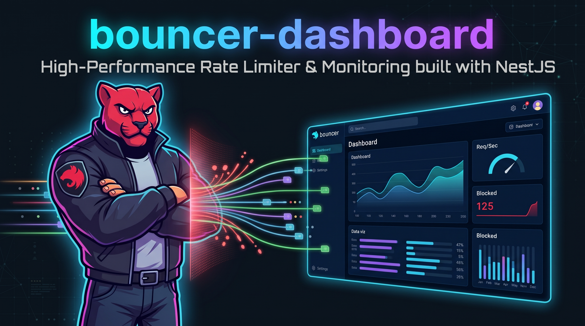

# bouncer-dashboard

A per-user API rate limiter built as a NestJS interceptor, with a live React and TypeScript dashboard for administering it. Shared quota state lives in Redis so several API processes enforce one limit; changes reach the dashboard over WebSockets.

## How this repository is built

The project was developed in a private repository, specification first, with AI assistants. It is replayed here as a sequence of pull requests so that the order of work can be reviewed:

- Each pull request follows the [specification-first process](docs/README.md#specifications).
- The base requirements come first. Improvements are added on top of them afterwards.
- Commit dates are those of the replay, not of the original development.

The replay is in progress; the merged pull requests show how far it has come.

## Commands

Node.js 22.22.3 or later (the exact ranges are in `engines` in
`package.json`), and Docker for Redis.

```sh
npm ci
npm run build
npm run lint
npm test                            # needs nothing running
npm run check:contracts             # the fixture data against its own rules
```

To run the API and the dashboard on the host:

```sh
docker compose up -d redis          # Redis on 127.0.0.1:6379
cp .env.example .env                # demo values; each one is explained there
npm run dev                         # API on :3000, dashboard on http://localhost:5173
```

`npm run start:dev -w apps/api` starts the API alone. The dashboard also runs
without an API, on fixture data:

```sh
VITE_FIXTURES=1 npm run dev -w apps/web
```

## Documentation

- [Requirements](docs/REQUIREMENTS.md): the assignment brief and the additional expectations.
- [Documentation map](docs/README.md): how the project is specified and where each kind of fact is written down.

## AI use

AI assistants helped plan, implement, review and test this project. Agent instructions are in [AGENTS.md](AGENTS.md).
