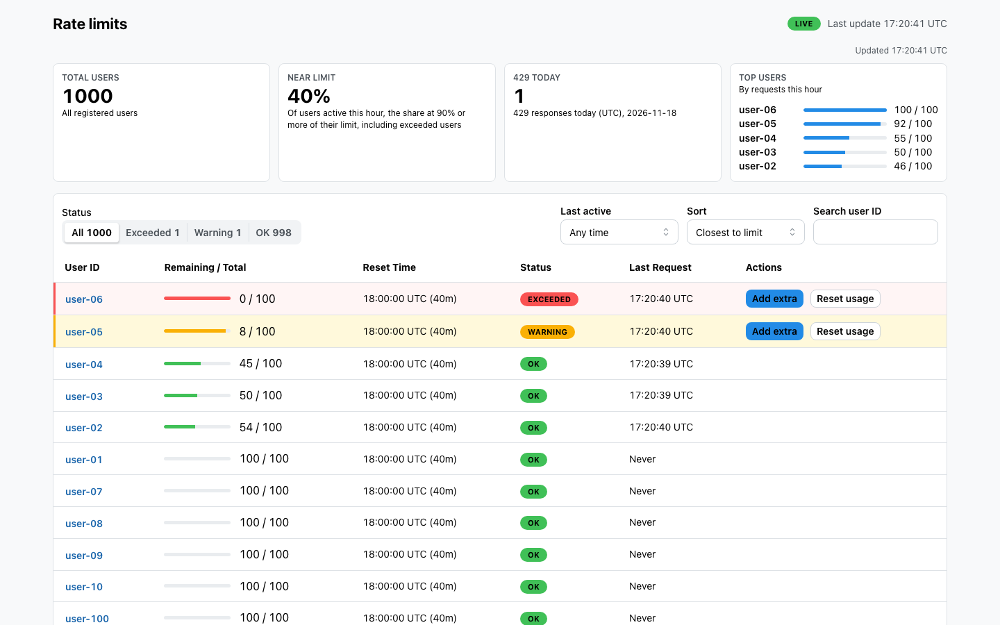
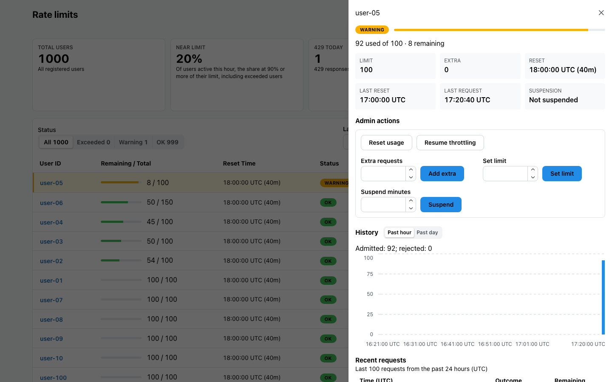
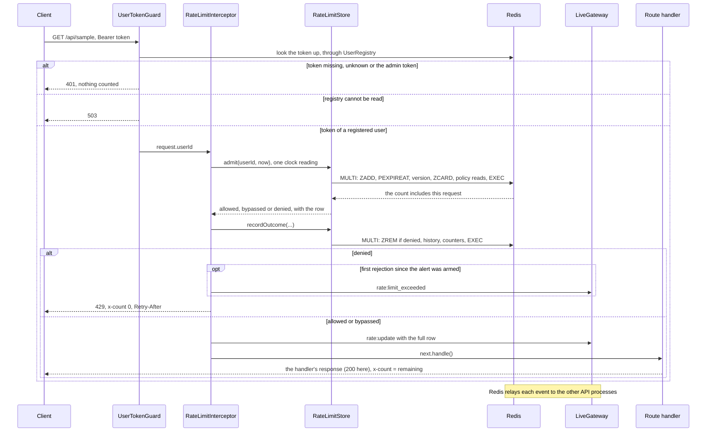
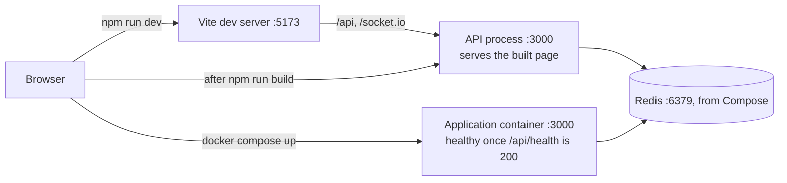
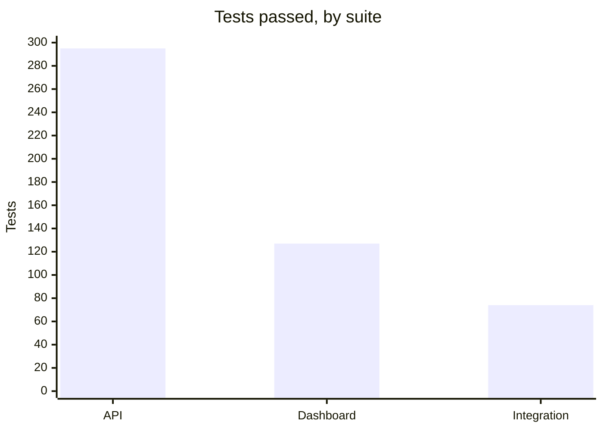
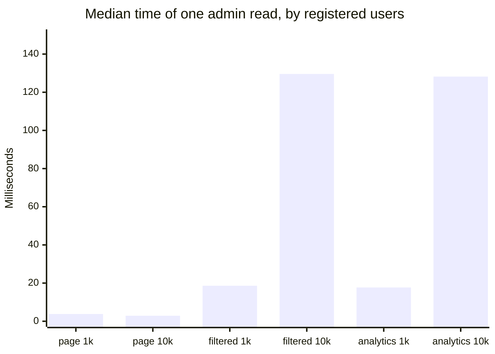

# bouncer-dashboard

A per-user API rate limiter built as a NestJS interceptor, with a live React and TypeScript dashboard for administering it. Redis holds the shared quota state, so every API process enforces one limit, and Socket.IO pushes each change to the connected dashboards.

| Asked                          | Built                                                                                                                                                                             |
| ------------------------------ | --------------------------------------------------------------------------------------------------------------------------------------------------------------------------------- |
| Rate-limiting interceptor      | `RateLimitInterceptor`: 100 requests per UTC hour per user ID, the remaining quota in `x-count`, 429 with the time to try again                                                   |
| Concurrency-proof counting     | One Redis transaction decides each admission                                                                                                                                      |
| Live dashboard                 | React, Vite and Mantine: live user table, user detail and history, admin controls, search and filters, analytics                                                                  |
| Live events                    | `rate:update` and `rate:limit_exceeded` over Socket.IO through `@nestjs/websockets`                                                                                               |
| Unit tests with a mock library | Store mocked with `vitest-mock-extended`; further tests against a real Redis and two API processes                                                                                |
| Additions                      | A user registry in Redis with a server-side paged list, detection of a Redis that stops answering, a health route, the dashboard served by the API, a container image and Compose |

What it is not: the tokens are demo credentials, there is one Redis without failover, live events are best effort and repaired by snapshot reads, and every check is a bounded run on one machine, without TLS and without a load test. Each specification ends in a Limits section. [What it does not do](docs/NOT-DOING.md) gathers them, with the reason for each.



The dashboard with 1000 seeded users, after the demo traffic of [Try it](#try-it).

## Try it

With Docker, and ports 3000 and 6379 free:

```sh
docker compose up --build --wait    # Redis and the application
```

Open http://127.0.0.1:3000 and sign in with the admin token `demo-admin-token`. Then send requests as a user, or let the demo script do it:

```sh
curl -i -H 'Authorization: Bearer demo-token-01' http://127.0.0.1:3000/api/sample    # 200, x-count: 99 on a fresh user
node scripts/traffic.mjs http://127.0.0.1:3000    # five users: three OK, one Warning, one Exceeded, then a trickle until Ctrl+C
docker compose down -v              # stops both and deletes the Redis data
```

Selecting a user opens its detail: usage and limit, the last reset, a history chart, the recent requests and, below them, the admin actions.



The demo values are in `.env.example`, which also explains each variable. The other run modes are under [Run it](#run-it).

## Architecture

![An API client and the admin dashboard call one NestJS API process (UserTokenGuard with UserRegistry, RateLimitInterceptor, route handler, AdminTokenGuard and AdminController, RateLimitStore, LiveGateway with its Redis adapter, HealthController and the static page at /), drawn in front of further API processes with the same code. The API process and the npm run seed:users command use one Redis instance holding the user registry, the quota keys and the Socket.IO Pub/Sub channel, while LiveGateway pushes rate:update and rate:limit_exceeded to the dashboard.](docs/images/system-overview.png)

A guard turns the bearer token into a user ID (401 for a missing or unknown token, 503 when the registry cannot be read, which the picture shortens to "else 401"); the interceptor admits or rejects the request in one Redis transaction. Admin actions go through the same store. An admitted request, an admin action and the first rejection of a window (again after a reset, a new limit or an extra grant) are pushed to connected dashboards as Socket.IO events, relayed between API processes through Redis. Delivery is best effort: a dashboard repairs what it shows from a snapshot read. The dashboard sends the admin token as a bearer header over HTTP and in the Socket.IO handshake.

### One request



The picture is the normal path. If Redis cannot be reached for the admission, the answer is 503 without `x-count`; if it becomes unreachable only while the outcome is recorded, the admission or the 429 stands; an error reply from Redis is a 500. The rules are in [rate limiting](docs/specs/rate-limiting.md#behavior) and its [limits](docs/specs/rate-limiting.md#limits).

## Decisions

Each decision is argued, with its alternatives and cost, in the specification it links to.

| Area          | Decision                                                                                                                                | Instead of                                             | Cost                                                                                                                 |
| ------------- | --------------------------------------------------------------------------------------------------------------------------------------- | ------------------------------------------------------ | -------------------------------------------------------------------------------------------------------------------- |
| Rate limiting | [One `MULTI`/`EXEC` decides admission; the count includes the request](docs/specs/rate-limiting.md#concurrent-safety)                   | A store-side script; `INCR` plus `EXPIRE`              | A second transaction per request, for bookkeeping                                                                    |
|               | [Fixed UTC-hour window, named by its start](docs/specs/rate-limiting.md#fixed-hour)                                                     | A rolling window                                       | Up to twice the cap across a boundary                                                                                |
|               | [Redis error reply is 500, unreachable Redis is 503](docs/specs/rate-limiting.md#error-classification)                                  | Parsing error messages                                 | Transient error replies are 500 too                                                                                  |
|               | [Written here, not taken from a limiter library](docs/specs/rate-limiting.md#written-here-not-taken-from-a-limiter-library)             | Nest's throttler; `rate-limiter-flexible`              | The window, its keys and their tests are code to maintain                                                            |
| Admin API     | [Each action is one transaction ending in a row read](docs/specs/admin-api.md#admin-writes-and-admission)                               | `WATCH` with retry; a lock; scripts                    | The write also queues the read                                                                                       |
|               | [Usage, limit and grant in separate keys](docs/specs/admin-api.md#usage-limit-and-grant-apart)                                          | One counter                                            | Five commands per row read                                                                                           |
|               | [Numbered pages, filtered by reading users in batches](docs/specs/admin-api.md#numbered-pages-filtered-by-reading-in-batches)           | A cursor; filtering in the browser; per-status indexes | Filtered pages and analytics take longer as users grow                                                               |
| Live updates  | [Events carry the full row and a per-user version](docs/specs/live-updates.md#full-row-with-a-version)                                  | Events that only name a user; timestamps               | Larger messages                                                                                                      |
|               | [One alert per window, re-armed by a generation](docs/specs/live-updates.md#one-alert-per-window-re-armed-by-a-generation)              | Deleting the flag; re-arming on a raised limit         | Lowering a limit can alert again that hour                                                                           |
|               | [Newer means later window, then higher version](docs/specs/live-updates.md#window-then-version-snapshots-repair)                        | Last arrival wins                                      | A snapshot read every 10 s while a dashboard is visible; page membership waits for it; a bounded buffer drops events |
|               | [Socket.IO Redis adapter between processes](docs/specs/live-updates.md#socketio-redis-adapter)                                          | One process; a hand-written channel; a broker          | Two more connections per process; events lost while Redis is down                                                    |
|               | [The detail response repairs a user off the page](docs/specs/live-updates.md#the-selected-users-detail-repairs-it-off-the-page)         | A detail panel with state of its own                   | One more case in the ordering rule                                                                                   |
|               | [Every dashboard receives every event](docs/specs/live-updates.md#every-dashboard-receives-every-event)                                 | Rooms per page or per selected user                    | Delivery grows with all requests times open dashboards                                                               |
| Platform      | [Identity from a bearer token, not a client-sent ID](docs/specs/platform.md#identity-comes-from-a-credential)                           | An identity provider                                   | Demo tokens are public                                                                                               |
|               | [Users registered in Redis, tokens stored as digests](docs/specs/platform.md#users-are-registered-in-redis-not-configured)              | A list in the environment; a file; a database          | One more Redis read per authenticated request; a Redis outage also fails authentication                              |
|               | [One types-only package for the shared contract](docs/specs/platform.md#one-types-only-package-carries-the-shared-contract)             | Nest monorepo mode                                     | A toolchain that cannot read TypeScript source would need a build step                                               |
|               | [Configuration checked once, before listening](docs/specs/platform.md#configuration-is-checked-once-before-listening)                   | `@nestjs/config`; reading variables where used         | A change needs a restart                                                                                             |
|               | [One error shape from one filter](docs/specs/platform.md#one-filter-gives-every-error-one-shape)                                        | Nest's default handling per route                      | The filter must follow Nest's error classes                                                                          |
|               | [Redis clients fail fast at start, then retry](docs/specs/platform.md#redis-clients-fail-fast-at-start-then-retry)                      | The client's defaults                                  | A peer that keeps sending an unfinished reply is not cut off                                                         |
|               | [A watchdog closes a connection that stops answering](docs/specs/platform.md#a-watchdog-closes-a-connection-that-has-stopped-answering) | A deadline per command; the socket timeout alone       | A command longer than the limit is cut off too; a write in flight may or may not have been applied                   |
|               | [The API serves the dashboard on one origin](docs/specs/platform.md#the-api-serves-the-dashboard)                                       | A static host or proxy; CORS                           | A changed page needs a new image                                                                                     |
| Dashboard     | [Mantine as the UI library](docs/specs/dashboard.md#ui-library-mantine)                                                                 | MUI, Ant Design, shadcn/ui, Chakra                     | Every screen is written against its components; replacing it rewrites the views                                      |
|               | [Responses and events checked by hand-written guards](docs/specs/dashboard.md#shape-checks-written-by-hand)                             | A schema library                                       | A field a guard omits goes unnoticed                                                                                 |
|               | [Live state in one hook](docs/specs/dashboard.md#live-state-in-one-hook-no-state-library)                                               | A query library                                        | Queueing, cancelling and ordering snapshot reads is code to maintain here                                            |
|               | [Fixture mode without a mock server](docs/specs/dashboard.md#fixture-mode)                                                              | A mock server                                          | Fixtures can drift; `check:contracts` guards them                                                                    |

### Where each quality is addressed

| Quality         | Decisions and limits                                                                                                                                                                                                                                                                                                                                                                                                            |
| --------------- | ------------------------------------------------------------------------------------------------------------------------------------------------------------------------------------------------------------------------------------------------------------------------------------------------------------------------------------------------------------------------------------------------------------------------------- |
| Architecture    | [shared contract](docs/specs/platform.md#one-types-only-package-carries-the-shared-contract), [one origin](docs/specs/platform.md#the-api-serves-the-dashboard), [one transaction per admission](docs/specs/rate-limiting.md#concurrent-safety), [adapter](docs/specs/live-updates.md#socketio-redis-adapter)                                                                                                                   |
| Scalability     | [registry](docs/specs/platform.md#users-are-registered-in-redis-not-configured), [pages](docs/specs/admin-api.md#numbered-pages-filtered-by-reading-in-batches), [adapter](docs/specs/live-updates.md#socketio-redis-adapter); limits of the [admin API](docs/specs/admin-api.md#limits) and [live updates](docs/specs/live-updates.md#limits)                                                                                  |
| Performance     | [full-row events](docs/specs/live-updates.md#full-row-with-a-version), [batched reads](docs/specs/admin-api.md#numbered-pages-filtered-by-reading-in-batches), [second transaction](docs/specs/rate-limiting.md#concurrent-safety)                                                                                                                                                                                              |
| Reliability     | [configuration](docs/specs/platform.md#configuration-is-checked-once-before-listening), [Redis clients](docs/specs/platform.md#redis-clients-fail-fast-at-start-then-retry), [watchdog](docs/specs/platform.md#a-watchdog-closes-a-connection-that-has-stopped-answering), [error classes](docs/specs/rate-limiting.md#error-classification), [event ordering](docs/specs/live-updates.md#window-then-version-snapshots-repair) |
| Security        | [identity](docs/specs/platform.md#identity-comes-from-a-credential), [token digests](docs/specs/platform.md#users-are-registered-in-redis-not-configured), [error shape](docs/specs/platform.md#one-filter-gives-every-error-one-shape), [admin input bounds](docs/specs/admin-api.md#behavior); limits of the [platform](docs/specs/platform.md#limits) and [dashboard](docs/specs/dashboard.md#limits)                        |
| Maintainability | [shared contract](docs/specs/platform.md#one-types-only-package-carries-the-shared-contract), [shape checks](docs/specs/dashboard.md#shape-checks-written-by-hand), [fixture mode](docs/specs/dashboard.md#fixture-mode), [coding rules](docs/CODING-RULES.md), [pitfalls](docs/PITFALLS.md)                                                                                                                                    |

### Reading the brief

Where the brief is ambiguous, the owning specification states the reading chosen.

| Brief                                       | Reading                                                                                                                                                                             | Where                                                 |
| ------------------------------------------- | ----------------------------------------------------------------------------------------------------------------------------------------------------------------------------------- | ----------------------------------------------------- |
| "based on user id, and not IP/MAC"          | The ID belongs to the bearer token; no address is read                                                                                                                              | [platform](docs/specs/platform.md#behavior)           |
| "Resets the count every hour"               | One UTC clock hour; Reset Time is the next boundary                                                                                                                                 | [rate limiting](docs/specs/rate-limiting.md#behavior) |
| "Limits each user to 100 requests per hour" | An admitted request counts even if its handler fails; a rejected one is taken out again when its outcome is recorded, and stays counted until the key expires if that cleanup fails | [rate limiting](docs/specs/rate-limiting.md#behavior) |
| "Warning >= 90%, OK <= 90%"                 | Exactly 90% is Warning                                                                                                                                                              | [rate limiting](docs/specs/rate-limiting.md#behavior) |
| "Reset limit"                               | Clears usage and this hour's extra grant; keeps the custom limit, suspension and history                                                                                            | [admin API](docs/specs/admin-api.md#behavior)         |
| "Suspend or unlock throttling temporarily"  | Ends at now plus the given minutes; requests over the cap are admitted and still counted                                                                                            | [admin API](docs/specs/admin-api.md#behavior)         |
| "Add extra requests within current window"  | Raises this hour's cap; ends at the hour                                                                                                                                            | [admin API](docs/specs/admin-api.md#behavior)         |
| "Real-time event stream for that user"      | The selected user's panel lists that user's request events as they arrive; it is not a log of admin actions                                                                         | [dashboard](docs/specs/dashboard.md#behavior)         |
| "Live User Table"                           | Server-side pages of 25, 50 or 100 users; filters and analytics read every registered user                                                                                          | [dashboard](docs/specs/dashboard.md#behavior)         |

## Run it

Node.js 22 (22.22.3 or later), 24 (24.15.0 or later) or 26 and later; `engines` in `package.json` is the reference. Docker for Redis. Choose one mode at a time: the API on the host and the application container both use port 3000.



| Mode            | Commands                                                                            | Page                  |
| --------------- | ----------------------------------------------------------------------------------- | --------------------- |
| Development     | `npm ci`, `docker compose up -d redis`, `cp .env.example .env` once, `npm run dev`  | http://localhost:5173 |
| One origin      | as above up to `.env`, then `npm run build` and `node apps/api/dist/main.js`        | http://localhost:3000 |
| Containers      | `docker compose up --build --wait`; `docker compose down -v` deletes the data       | http://127.0.0.1:3000 |
| Dashboard alone | `VITE_FIXTURES=1 npm run dev -w apps/web`: fixture data, no API, any token signs in | http://localhost:5173 |

On the host the API reads `.env`; the container reads `.env.example`, so a change to `.env` does not reach it. In every mode the admin token is `demo-admin-token` and the users are `user-01` to `user-12` with tokens `demo-token-01` to `demo-token-12`.

`npm run seed:users -- --count 1000` adds the users from `user-01` to `user-1000` that are missing, with tokens `demo-token-01` onwards; a user that exists keeps its token and its quota state. `npm run demo:traffic` sends requests as five demo users, which on a fresh state leaves three OK, one at Warning and one Exceeded, then keeps a slow trickle until Ctrl+C. It targets http://localhost:3000, or the base URL given after `--`.

## Verification

Results, with date, revision and what was not checked, are in [VERIFICATION.md](docs/VERIFICATION.md).

```sh
npm ci
npm run build
npm run lint
npm test                            # needs nothing running
npm run check:contracts             # the fixture data against its own rules
```

The remaining checks empty the Redis database they are given, and Socket.IO events cross database numbers, so they need a Redis server of their own and not another database of the development one. Run them one after another:

```sh
docker run -d --rm --name bouncer-test-redis -p 127.0.0.1:6380:6379 redis:8-alpine
export TEST_REDIS_URL=redis://127.0.0.1:6380/1
npm run test:integration            # after a build
npm run check:two-process           # after a build: two API processes, ports 3203 and 3204
npm run check:population            # one API on PORT (default 3001), at 1000 and 10000 users
docker stop bouncer-test-redis
```

Without `TEST_REDIS_URL` the first two fall back to database 1 of the Compose Redis, which nothing else may then use; the population check refuses to start.

The last full run, on one laptop, at the revision the record names:

| Check                                             | Result                                                                                                                                                                  |
| ------------------------------------------------- | ----------------------------------------------------------------------------------------------------------------------------------------------------------------------- |
| `npm test`                                        | 295 API tests in 16 files and 127 dashboard tests in 14 files passed                                                                                                    |
| `npm run check:contracts`                         | 134 fixture checks passed                                                                                                                                               |
| `npm run test:integration`                        | 74 tests in 14 files passed against a real Redis, five runs in a row                                                                                                    |
| `npm run check:two-process`                       | 200 requests at once for one user over two API processes: 100 admitted, 100 rejected, 0 other; three runs                                                               |
| `npm run check:population`                        | The list page, a filtered page and the analytics timed at 1000 and 10000 registered users; three runs                                                                   |
| `docker compose up --build --wait`, then Chromium | Both containers healthy. Of 14 browser items, 12 passed; the hidden tab was not checked, and the console held one unexplained WebSocket warning after a refused sign-in |





Each bar is the median of three runs, and each run is the median of ten sequential HTTP reads of one admin route on one API process: an unfiltered page reads only its own rows and stays flat, while a filtered page and the analytics read every registered user and grow with the population. It is not admission latency and not a load test.

Verification covers bounded concurrency and population runs on one machine. Sustained load, more than one host and TLS were not checked; each specification's Limits section says what it does not prove.

## Documentation

- [Requirements](docs/REQUIREMENTS.md): the brief and the additional expectations.
- [Documentation map](docs/README.md): how the project is specified and where each kind of fact is written down.
- Specifications: [platform](docs/specs/platform.md), [rate limiting](docs/specs/rate-limiting.md), [live updates](docs/specs/live-updates.md), [admin API](docs/specs/admin-api.md), [dashboard](docs/specs/dashboard.md).
- [Verification](docs/VERIFICATION.md): what was run, at which revision, and each requirement mapped to the test or command that shows it.
- [What it does not do](docs/NOT-DOING.md): each omission, its reason and its cost, linked to where it is defined.
- [Pitfalls](docs/PITFALLS.md): what goes wrong in systems like this one; [coding rules](docs/CODING-RULES.md).

## How this repository is built, and AI use

The project is built specification first, as a sequence of pull requests:

- Each pull request follows the [specification-first process](docs/README.md#specifications).
- The base requirements come first. Improvements are added on top of them afterwards.

AI assistants helped plan, implement, review and test this project. Agent instructions are in [AGENTS.md](AGENTS.md).
