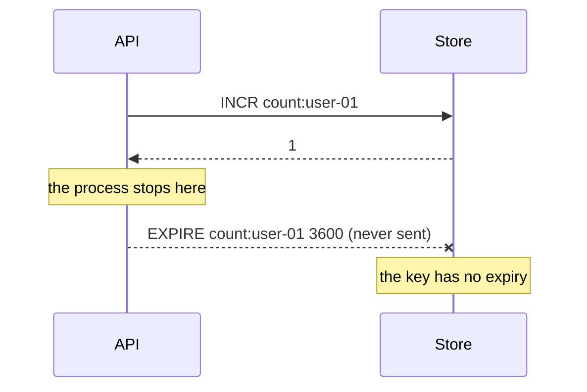
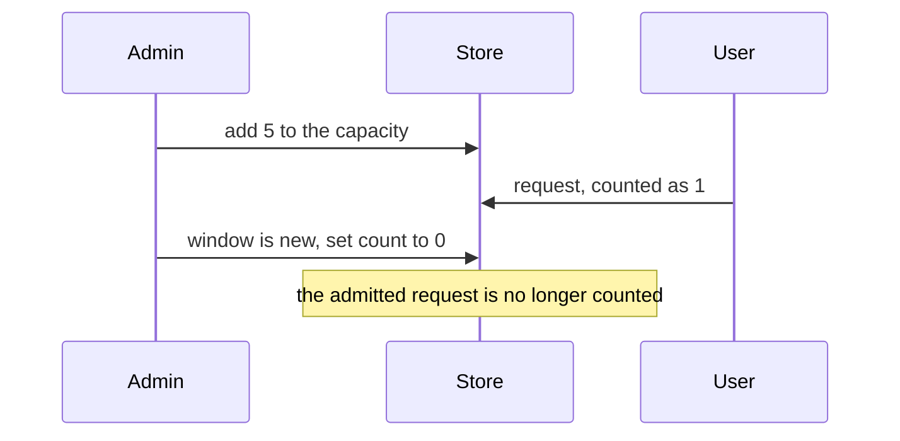
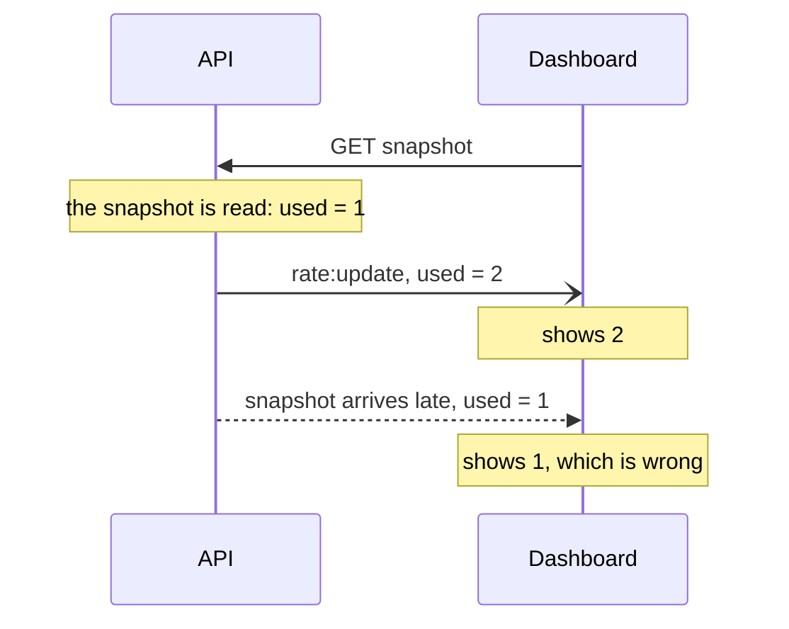

# Pitfalls

Ways a flawed implementation of a per-user rate limiter with a live
administration dashboard goes wrong. They were collected before the design
was written and are read before any part of it is designed or changed.

An item is listed only when it concerns something this repository builds.
Each one names the fault, the rule that prevents it here and a check planned
to catch it. A snippet or diagram illustrates the fault; it was written for
this document and is not code from this repository.


The **Guard** line is a summary. The rule itself is defined in the
specification that owns the topic; where it rests on a reading of an
ambiguous requirement, that reading is marked as an interpretation there,
not here. The **Check** line gives a short example of a case and where it
runs. The specification's test plan holds the full list, and
`VERIFICATION.md` records what was run and with what result. Both are linked
from here as they are written.

The first rule covers every item: where the brief is clear it is
implemented as written, and where it is ambiguous the chosen reading is
recorded as an interpretation before any code depends on it.

## Reading the brief

### P1. Renaming what the brief names

A flawed implementation gives the table a clearer-sounding column or an
event a tidier name. The reviewer then looks for "Reset Time" and
`rate:update` and does not find them.

**Guard:** the columns User ID, Remaining / Total, Reset Time, Status and
Last Request, the events `rate:update` and `rate:limit_exceeded` and the
header `x-count` keep the brief's names.
**Check:** browser environment: the table renders those five headers. The
shared event map is type-checked against both applications.

### P2. Putting the used count in `x-count`

The brief defines the header as the remaining requests. A flawed
implementation has the used count at hand and writes that.

```ts
const used = await store.increment(userId)
response.setHeader('x-count', `${used}`) // 1, 2, 3 … instead of 99, 98, 97 …
```

**Guard:** the header is the remaining value of the row that the admission
itself produced. It is not computed a second time.
**Check:** real store: at the default limit the first request answers 99,
the hundredth answers 0, and the next is a 429 with `x-count: 0`.

### P3. A status threshold that only works for round limits

A flawed implementation derives the Warning threshold by rounding, which is
right for a limit of 100 and wrong for a custom one.

```ts
// Limit 11: ceil(1.1) = 2, so 9 of 11 used (81.8%) is already "Warning".
if (remaining <= Math.ceil(limit * 0.1)) status = 'Warning'
```

**Guard:** one function decides every row's status with integer
comparisons: Exceeded at the cap, otherwise Warning when
`used * 10 >= total * 9`. Which status exactly 90% gets is an interpretation
of the brief.
**Check:** unit test: limits that are not multiples of ten, and the cases
just below 90%, at 90% and at 100%.

### P4. A "near limit" figure that drops when users get blocked

A flawed implementation counts only users in Warning, so the card falls as
users reach 100%, which is when it should be highest.

**Guard:** the brief does not define the figure. The definition chosen is
the share of users active in the current window that are at 90% or more,
Exceeded included, and the card prints it.
**Check:** real store: the analytics and the rows returned for the same
moment agree. Browser environment: the card shows the definition.

## Admission

### P5. Setting the count and its expiry in two steps

A flawed implementation creates the counter with one command and gives it
its expiry with another. If the process stops between them, the key outlives
its intended lifetime.



**Guard:** the entry and the expiry of its key are queued in the same
transaction, on every request and not only the first.
**Check:** mocked store: the expiry is queued inside the admission
transaction. Real store: every key the system writes has its specified
expiry or is one of the documented keys that exist once per registered user
or hold the registry.

### P6. Rejections that multiply work

A blocked client usually retries at once. In a flawed implementation every
429 is also announced to every dashboard, and each dashboard fetches in
response, so the work grows fastest exactly when requests are being refused.

**Guard:** a rejection runs a short, fixed sequence of store commands.
`rate:limit_exceeded` is sent for a user's first rejection in a window; a
reset, an extra grant or a saved limit allows one more. The state left by
later rejections reaches the dashboard through its periodic snapshot.
**Check:** real store: a burst of rejections produces one alert, and each of
those three actions re-arms exactly one.

### P7. One user's flood slowing everyone else

A flawed implementation waits for something that belongs to one user while
it holds a resource all users need, such as a pooled connection. A single
user who floods the API then delays all the others. It also presents an
input bound, such as a maximum limit of 10 000, as if it were capacity.

**Guard:** the admission decision is one short transaction, and the
application never waits for a per-user lock while holding a shared resource.
Redis itself remains shared. A capacity or performance statement appears
only with the measurement behind it.
**Check:** real store: while one user sends 1000 rejected requests, 20
requests of another user each complete in under a second. This is a bounded
probe, not a load test.

### P8. Catching every error around the store call

```ts
try {
  decision = await store.admit(userId)
} catch {
  throw new ServiceUnavailableException('No quota was used. Retry safely.')
}
```

A flawed implementation like this one reports a defect in its own code as an
outage, loses the cause, and promises what it cannot know: the store may
have counted the request before the failure.

**Guard:** only the store's own "unavailable" error becomes a 503, and its
cause is logged. Any other error stays a 500. The 503 says the request was
not processed and makes no statement about the quota.
**Check:** mocked store: an unavailable store gives 503 and the handler does
not run; an unexpected error is not turned into a 503.

### P9. Storing something without a bound

A flawed implementation relies on the quota to bound what it stores. The
quota bounds admitted requests. It does not bound rejections, requests
during a suspension or the history kept for the dashboard.

**Guard:** every key has an expiry, a maximum length or exists once per
registered user; the registry's keys grow with the users registered. An expiry bounds how long data lives, not how much there is
at once: traffic during a suspension, or a rejection whose cleanup failed,
still grows the current window's set until its key expires. The application
enforces no bound on peak memory.
**Check:** real store: each key has its specified expiry or is one of the
per-user keys; the recent-request list holds 100 records after 150 attempts.

### P10. Discovering bad configuration on a request

A flawed implementation reads a configuration value where it is used, inside
a guard. A missing value then fails every request, one at a time, in
production.

**Guard:** the configuration is validated once at startup, and the process
refuses to start with all problems listed.
**Check:** unit test: a valid environment parses; every problem is reported
in one error; no credential appears in it.

### P11. A user ID that is not one plain string

A flawed implementation lets an ID contain the separator used in storage
keys, and part of the ID is lost on the way back.

```ts
const userId = key.split(':')[1] // "count:eu:user-07" yields "eu"
```

**Guard:** a user ID matches one pattern that excludes the key separator.
An ID outside the pattern is rejected when the configuration is loaded. The
same string is used in the store, the row, the route and the search.
**Check:** real store: an ID with upper case, an underscore and a hyphen
comes back unchanged from a request, an admin route and an event.

## Admin actions

### P12. A "temporary" suspension that never ends

The brief asks to temporarily suspend throttling. A flawed implementation
stores the suspension as a boolean flag, which has no end and survives every
reset.

**Guard:** a suspension requires an end time. Admission compares the stored
end time with the request's own clock reading, so it ends on time with no
background job. The dashboard shows the end time.
**Check:** real store: a request just before and one at the end time; a
suspension that ends while no request arrives.

### P13. Usage, base limit and grant in one number

A flawed implementation keeps one number per user and writes every admin
action to it. "Add extra requests" then lowers what is left, a grant meant
for "the current window" stays for good, and an action that prepares a new
window erases a request that arrived just before it.

```ts
await redis.incrBy(`count:${userId}`, extra) // remaining goes down, not up
```



**Guard:** usage, the custom limit and the grant are three separate keys. A
grant or a limit change never overwrites admitted usage; within a window
only an explicit reset clears it. A grant's key names its window, so it
stops counting at the hour boundary.
**Check:** real store: a grant of five adds exactly five, leaves usage
untouched and is gone in the next window; a grant placed between two
controlled batches of admissions keeps every admitted entry of both.

### P14. A reset that resets the policy and not the usage

In a flawed implementation "Reset" restores the default limit and leaves the
count where it was, so the exhausted user is still rejected. Its "last
reset" knows only this manual action, although the count also resets every
hour.

**Guard:** a reset clears the usage and the extra grant of the current
window and keeps the custom limit. The last reset is the later of the
current window's start and the last manual reset.
**Check:** real store: exhaust the quota, reset, and the next request is
admitted with the custom limit unchanged. Unit test: last reset with and
without a manual reset.

### P15. Answering before the write has settled

```ts
@Post(':userId/reset')
reset(@Param('userId') userId: string) {
  this.users.reset(userId) // the promise is dropped
  return { ok: true }      // sent before the store has answered
}
```

A flawed implementation like this one shows the admin success for a write
that may fail a moment later, and the failure has no response left to go to.

**Guard:** an action's response and its event wait for the write.
**Check:** mocked store: a delayed write delays the response; a rejected
write produces an error response and no event.

### P16. Admin input that reaches the store unchecked

A flawed implementation states its bounds only in the API description. A
negative grant then reduces capacity, a limit sent as a string is stored and
breaks the next admission, and a mistyped user ID silently becomes a new
user.

**Guard:** before anything is written, a user that is not registered
answers 404 and a body value that is not an integer in its stated range, or
a field that is not expected, answers 400.
**Check:** real store: wrong types, non-integers, out-of-range values and an
unknown user leave the state unchanged and the process running.

### P17. Retrying an admin action automatically

A reset whose response was lost looks safe to send again, and a flawed
implementation sends it. If requests were admitted in between, the second
reset clears usage the first one never saw.

**Guard:** the dashboard never repeats an admin action on its own. After an
uncertain outcome it reads the state again and shows the error until that
read succeeds; the admin decides what to do next.
**Check:** browser environment: an action that fails is sent once, and the
state shown afterwards comes from a fresh read.

## Live updates

### P18. Events that only say "something changed"

A flawed implementation sends events that carry just a user ID, fetches on
each one and drops any fetch that a newer event has overtaken. Under steady
traffic the fetches are slower than the events and no response is ever
applied.

```mermaid
sequenceDiagram
    participant API
    participant Page as Dashboard
    API-)Page: changed (t = 0 ms)
    Page->>API: fetch 1
    API-)Page: changed (t = 200 ms)
    Note over Page: fetch 1 is now stale and will be dropped
    Page->>API: fetch 2
    API-)Page: changed (t = 400 ms)
    Note over Page: fetch 2 is stale as well; the table never moves
```

**Guard:** an event carries the user's full row and a version and is applied
directly. No event causes a fetch. Snapshots are a repair path: one in
flight and at most one queued behind it. Asking for another does not cancel
the one that is running.
**Check:** browser environment: events are applied without any request;
requests for a snapshot during a pending one are merged into a single
follow-up.

### P19. An older snapshot overwriting a newer event

A flawed implementation shows whatever arrived last, whether it came from
the socket or from an HTTP response.



**Guard:** both sources go through one ordering: a later window wins, then a
higher version. A snapshot may replace a row of the same version, which is
how a suspension that ended unobserved is repaired, and never a newer one.
**Check:** browser environment: a snapshot delayed past an event leaves the
event's row in place; a row of an earlier window is ignored whatever its
version; a snapshot of the same version replaces the row.

### P20. Taking a connection for delivery

A flawed implementation assumes that two API processes sharing the counter
also share their dashboards, and that a connected socket means current
numbers. A dashboard connected to one process misses the decisions made by
the other and shows "Live" over a stale table.

**Guard:** events are relayed between processes through the Socket.IO Redis
adapter. A missed event is not replayed: a snapshot on connect, on
reconnect, when the page becomes visible, at the hour boundary and at a
fixed interval while it is visible repairs the rows. Next to the connection
state the page shows the time of the last event or snapshot it accepted.
**Check:** two operating-system processes: a request and a reset handled by
one reach a dashboard connected to the other. Browser environment: the
displayed time is set by an accepted event or a successful snapshot, not by
the connection alone.

### P21. Removing another component's listeners

```ts
useEffect(() => {
  socket.on('rate:update', onUpdate)
  return () => socket.off('rate:update') // removes every listener of the event
}, [])
```

A flawed implementation cleans up like this, and closing one view silences
the table.

**Guard:** one hook owns the socket, and it removes exactly the callbacks it
added.
**Check:** browser environment: after the detail view is closed the table
still updates; unmounting removes only the hook's own callbacks and timers.

## Dashboard

### P22. Applying a response without checking what it was for

The admin opens user A, then user B, or signs in again. A flawed
implementation shows A's slower response under B, applies an admin action's
result to whoever is selected when it returns, and lets a late 401 from the
old session clear the new one.

**Guard:** each response is checked against the resource and the session it
was requested for and is dropped on a mismatch. An action is applied to the
user it was sent for. Separately, every request has a timeout, so none stays
open without end.
**Check:** browser environment: A, then B, then A again drops the first A
response; an action completes on its original user after another is opened;
a late response of a replaced session has no effect.

### P23. Essential data waiting for optional data

A flawed implementation loads everything a view needs in one step and keeps
session, socket, selection and forms in one component, so one failing
request leaves the whole view without data.

```ts
const [stats, history, analytics] = await Promise.all([
  loadStats(userId),
  loadHistory(userId),
  loadAnalytics(), // if this rejects, stats and history are never rendered
])
```

**Guard:** the page is split by responsibility: session, live rows, table,
detail, admin forms and analytics. Each loads and fails on its own and keeps
its previous data while it refreshes.
**Check:** browser environment: the table keeps working when the analytics
request fails, and the detail view keeps the known row when its history
request fails.

## Tests and claims

### P24. Tests that do not exercise what runs

The brief requires unit tests against a mocked store. They show how a
decision becomes headers and errors. A flawed test suite stops there, tests
a second copy of the quota formula written for the test, leaves the
dashboard's asynchronous paths untested, or starts two application objects
in one process and calls them two replicas. None of that shows that requests
arriving together are counted correctly, and a green suite can still assert
the wrong reading of the brief.

**Guard:** three tiers that prove different things. Unit tests mock the
store and call the production functions. A second tier runs the same code
against a real store. A third starts two operating-system processes. The
dashboard's delayed and out-of-order responses have their own tests, and
every numbered requirement is mapped to the check or demonstration step that
shows it.
**Check:** real store: 200 concurrent requests of one user admit exactly
100. Two processes: each one admits against the shared counter, 200
concurrent requests split between them admit exactly 100, and the stored
usage is 100.

### P25. Time tests that do not control time

A flawed boundary test reads the real clock. It runs somewhere inside the
hour on almost every run and proves nothing about the boundary.

**Guard:** the clock is read once per request and passed on, so a test can
supply the time.
**Check:** unit test and real store: the hour boundary one millisecond
before, at and one millisecond after, with the time supplied by the test.
