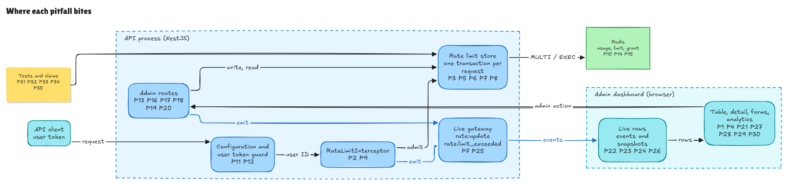
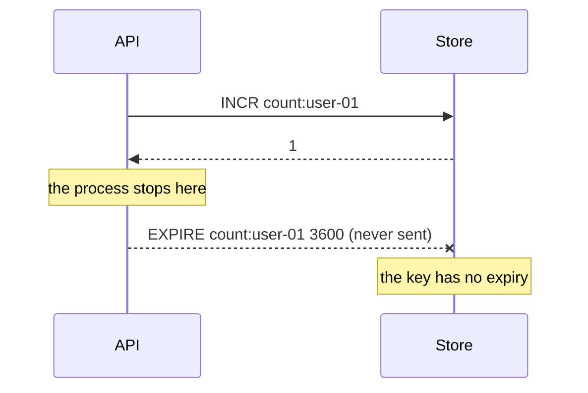
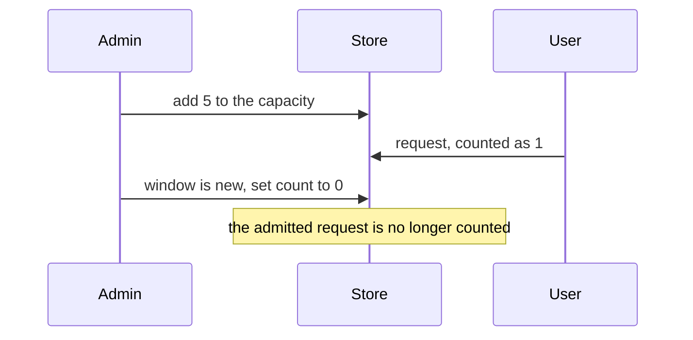
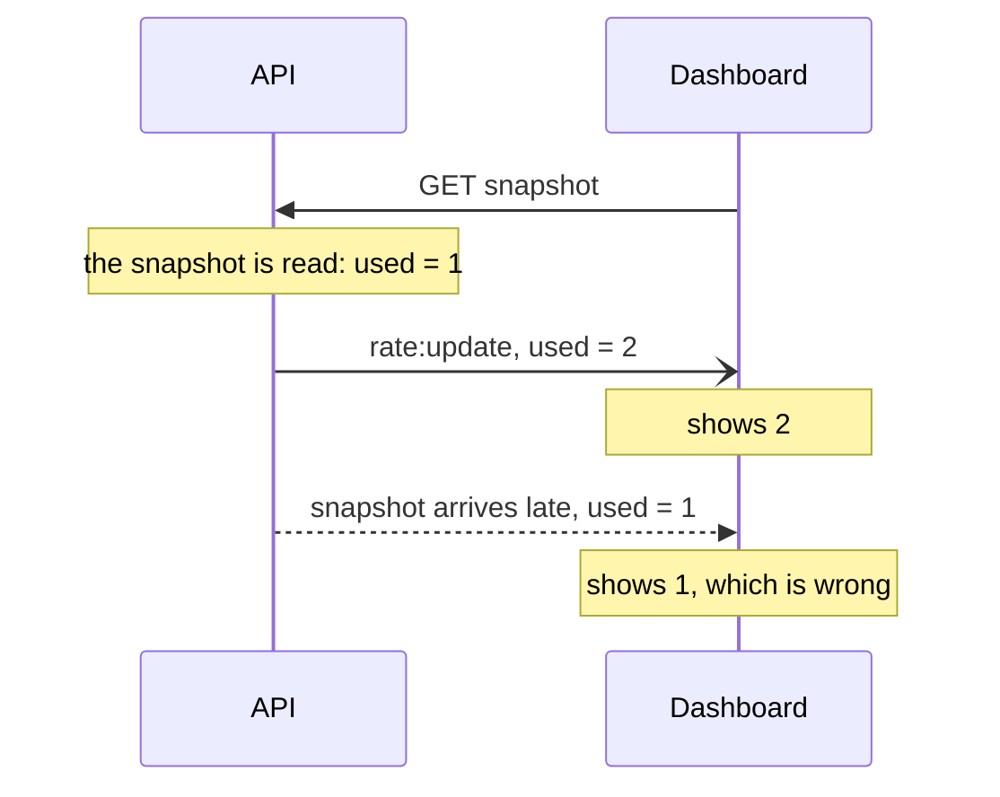

# Pitfalls

Ways a flawed implementation of a per-user rate limiter with a live
administration dashboard goes wrong. They were collected before the design
was written and are read before any part of it is designed or changed.

An item is listed only when it concerns something this repository builds.
Each one names the fault, the rule that prevents it here and the check
planned to catch it. A snippet or diagram illustrates the fault; it was
written for this document and is not code from this repository.



The **Guard** line is a summary. The rule itself is defined in the
specification that owns the topic; where it rests on a reading of an
ambiguous requirement, that reading is marked as an interpretation there,
not here. The **Check** line names the case to write and where it runs. The
specification's test plan holds the full list, and `VERIFICATION.md` records
what was run and with what result. Both are linked from here as they are
written.

The first rule covers every item: where the brief is clear it is
implemented as written, and where it is ambiguous the chosen reading is
recorded as an interpretation before any code depends on it.

## Reading the brief

### P1. Renaming what the brief names

A flawed implementation gives the table a clearer-sounding column or an
event a tidier name. The reviewer then looks for "Reset Time" and
`rate:update` and does not find them.

**Guard:** the columns User ID, Remaining / Total, Reset Time, Status and
Last Request, the events `rate:update` and `rate:limit_exceeded` and the
header `x-count` keep the brief's names.
**Check:** browser environment: the table renders those five headers. The
shared event map is type-checked against both applications.

### P2. Putting the used count in `x-count`

The brief defines the header as the remaining requests. A flawed
implementation has the used count at hand and writes that.

```ts
const used = await store.increment(userId)
response.setHeader('x-count', `${used}`) // 1, 2, 3 … instead of 99, 98, 97 …
```

**Guard:** the header is the remaining value of the row that the admission
itself produced. It is not computed a second time.
**Check:** real store: at the default limit the first request answers 99,
the hundredth answers 0, and the next is a 429 with `x-count: 0`.

### P3. A status threshold that only works for round limits

The brief gives Warning at 90% and its ranges overlap at exactly 90%. A
flawed implementation derives the threshold by rounding, which is right for
a limit of 100 and wrong for a custom one.

```ts
// Limit 11: ceil(1.1) = 2, so 9 of 11 used (81.8%) is already "Warning".
if (remaining <= Math.ceil(limit * 0.1)) status = 'Warning'
```

**Guard:** one function compares integers, `used * 10 >= total * 9`, and
every row comes from that function. Which status exactly 90% gets is an
interpretation of the brief.
**Check:** mocked store: limits that are not multiples of ten, and the cases
just below 90%, at 90% and at 100%.

### P4. A "near limit" figure that drops when users get blocked

A flawed implementation counts only users in Warning, so the card falls as
users reach 100%, which is when it should be highest.

**Guard:** the brief does not define the figure. The definition chosen is
the share of users active in the current window that are at 90% or more,
Exceeded included, and the card prints it.
**Check:** real store: the analytics, the table and the detail view agree on
the same users and thresholds.

### P5. A "last reset" that only knows manual resets

The brief asks for the last reset time. A flawed implementation records
only the admin's reset, so a user who has never been reset manually has
none, although the count resets every hour.

**Guard:** the last reset is the later of the current window's start and the
last manual reset.
**Check:** mocked store: a row without a manual reset, and one with a manual
reset from an earlier window.

## Admission

### P6. Setting the count and its expiry in two steps

A flawed implementation creates the counter with one command and gives it
its expiry with another. If the process stops between them, the counter
never expires and the user stays limited for good.



**Guard:** the entry and the expiry of its key are queued in the same
transaction, on every request and not only the first.
**Check:** mocked store: the expiry is queued inside the transaction, before
the count is read. Real store: every key the system writes carries its
specified expiry.

### P7. Rejections that multiply work

A blocked client usually retries at once. In a flawed implementation every
429 is also announced to every dashboard, and each dashboard fetches in
response, so the work grows fastest exactly when requests are being refused.

**Guard:** a rejection runs a short, fixed sequence of store commands.
`rate:limit_exceeded` is sent for the first rejection only; a reset, an
extra grant or a saved limit allows one more. Later rejections reach the
dashboard through its periodic snapshot.
**Check:** real store: a burst of rejections produces one alert, and each of
those three actions re-arms exactly one.

### P8. One user's flood slowing everyone else

A flawed implementation holds a shared resource while it waits on something
that belongs to one user. A single user who floods the API then delays all
the others.

**Guard:** an admission is one short transaction on that user's own keys.
Nothing shared is held while it runs.
**Check:** real store: while one user sends 1000 rejected requests, 20
requests of another user each complete in under a second. This is a bounded
probe, not a load test.

### P9. Catching every error around the store call

```ts
try {
  decision = await store.admit(userId)
} catch {
  throw new ServiceUnavailableException('Nothing was changed.')
}
```

A flawed implementation like this one reports a defect in its own code as
an outage, loses the cause, and promises more than it knows: the store may
have counted the request before the failure.

**Guard:** only the store's own "unavailable" error becomes a 503, and its
cause is logged. Any other error stays a 500. The 503 says the request was
not processed and makes no statement about the quota.
**Check:** mocked store: an unavailable store gives 503 and the handler does
not run; an unexpected error is not turned into a 503.

### P10. Storing something without a bound

A flawed implementation relies on the quota to bound what it stores. The
quota bounds admitted requests. It does not bound rejections, requests
during a suspension or the history kept for the dashboard.

**Guard:** every key has an expiry, a maximum length or a cardinality fixed
by the configured users. An expiry bounds how long data lives, not how much
there is at once: traffic during a suspension, or a rejection whose cleanup
failed, still grows the current window's set until its key expires. There is
no limit on peak memory.
**Check:** real store: every written key has its expiry; the recent-request
list holds 100 records after 150 attempts.

### P11. Discovering bad configuration on a request

A flawed implementation reads a configuration value where it is used, inside
a guard. A missing value then fails every request, one at a time, in
production.

**Guard:** the configuration is validated once at startup, and the process
refuses to start with all problems listed.
**Check:** mocked store: a valid environment parses; every problem is
reported in one error; no credential appears in it.

### P12. A user ID that is not one plain string

A flawed implementation lets an ID contain the separator used in storage
keys, and part of the ID is lost on the way back.

```ts
const userId = key.split(':')[1] // "count:eu:user-07" yields "eu"
```

**Guard:** a user ID matches one pattern that excludes the key separator.
An ID outside the pattern is rejected when the configuration is loaded. The
same string is used in the store, the row, the route and the search.
**Check:** real store: an ID with upper case, an underscore and a hyphen
comes back unchanged through every route and event.

## Admin actions

### P13. A "temporary" suspension that never ends

The brief asks to temporarily suspend throttling. A flawed implementation
stores the suspension as a boolean flag, which has no end and survives every
reset.

**Guard:** a suspension requires an end time. Admission compares the stored
end time with the request's own clock reading, so it ends on time with no
background job. The dashboard shows the end time.
**Check:** real store: a request just before, at and just after the end
time; a suspension that expires while no request arrives.

### P14. Extra requests that become a permanent raise

The brief grants extra requests "within the current window". A flawed
implementation adds them to the user's limit, where they are still there
next hour.

**Guard:** a grant is stored under a key that names its window, so it stops
counting at the hour boundary. The key itself is deleted later.
**Check:** real store: a grant of five adds exactly five and is gone in the
next window.

### P15. Usage, base limit and grant in one number

A flawed implementation keeps one number per user and writes every admin
action to it.

```ts
// "Add extra requests" written to the usage counter:
await redis.incrBy(`count:${userId}`, extra) // remaining goes down, not up
```

**Guard:** usage, the custom limit and the grant are three separate keys.
Only a request adds usage and only a reset clears it.
**Check:** real store: a grant raises remaining and leaves usage untouched;
a changed limit leaves usage untouched, also when it is below the usage.

### P16. A reset that resets the policy and not the usage

In a flawed implementation "Reset" restores the default limit and leaves
the count where it was. The exhausted user is still rejected.

**Guard:** a reset clears the usage and the extra grant of the current
window and keeps the custom limit.
**Check:** real store: exhaust the quota, reset, and the next request is
admitted; the custom limit is unchanged.

### P17. Initializing a window after it has been used



A flawed implementation runs an admin action in two steps. When the action
and a first request arrive together, its second step erases the request,
and more requests are admitted than the cap.

**Guard:** there is no initialization step. A window exists from its first
entry, a grant only increments its own key, and a reset is the only
operation that removes usage.
**Check:** real store: a grant placed between two controlled batches of
admissions keeps every admitted entry of both.

### P18. Answering before the write has settled

```ts
@Post(':userId/reset')
reset(@Param('userId') userId: string) {
  this.users.reset(userId) // not awaited
  return { ok: true }      // sent before the store has answered
}
```

A flawed implementation like this one shows the admin success for a write
that may fail a moment later, and the failure has no response left to go
to.

**Guard:** an action awaits its write, then emits the event, then returns
the new row.
**Check:** mocked store: a delayed write delays the response; a rejected
write produces an error response and no event.

### P19. An admin action that creates a user

In a flawed implementation a mistyped ID in an admin request silently
becomes a new user with a custom limit.

**Guard:** an action on a user that is not configured answers 404 and
changes nothing.
**Check:** real store: an unknown user on every admin route.

### P20. Documented bounds that nothing enforces

A flawed implementation states its bounds only in the API description. A
negative grant then reduces capacity, and a limit sent as a string is stored
and breaks the next admission.

**Guard:** every body value is validated before anything is written:
integers only, within the stated range, no unknown fields. The ranges are
input checks and say nothing about capacity.
**Check:** real store: wrong types, non-integers and out-of-range values
answer 400, the state is unchanged and the process keeps running.

### P21. Retrying an admin action automatically

A reset whose response was lost looks safe to send again, and a flawed
implementation sends it. If requests were admitted in between, the second
reset clears usage the first one never saw.

**Guard:** the dashboard never repeats an admin action on its own. After an
uncertain outcome it shows the current state and the admin decides.
**Check:** browser environment: an action that fails is sent once, and the
state shown afterwards comes from a fresh read.

## Live updates

### P22. Events that only say "something changed"

A flawed implementation sends events that carry just a user ID, so every
change makes every open dashboard fetch. Under steady traffic the fetches
are slower than the events, each new event supersedes the fetch in flight,
and no response is ever applied.

```mermaid
sequenceDiagram
    participant API
    participant Page as Dashboard
    API-)Page: changed (t = 0 ms)
    Page->>API: fetch 1
    API-)Page: changed (t = 200 ms)
    Note over Page: fetch 1 is now stale and will be dropped
    Page->>API: fetch 2
    API-)Page: changed (t = 400 ms)
    Note over Page: fetch 2 is stale as well; the table never moves
```

**Guard:** an event carries the user's full row and a version and is applied
directly. No event causes a fetch. Snapshots are a repair path: one in
flight and at most one queued behind it. Asking for another does not cancel
the one that is running.
**Check:** browser environment: events are applied without any request;
requests for a snapshot during a pending one are merged into a single
follow-up.

### P23. An older snapshot overwriting a newer event

A flawed implementation shows whatever arrived last, whether it came from
the socket or from an HTTP response.



**Guard:** both sources go through one ordering: a later window wins, then a
higher version. A snapshot may replace an equal version and never a newer
one.
**Check:** browser environment: a snapshot delayed past an event leaves the
event's row in place; a row of an earlier window is ignored whatever its
version.

### P24. Showing "connected" as "current"

A socket can be connected while the table is minutes behind. A flawed
implementation reports the connection alone and says "Live" over stale
numbers.

**Guard:** next to the connection state the page shows the time of the last
update it applied.
**Check:** browser environment: the time advances with an applied event or
snapshot and not with the connection alone.

### P25. Taking shared admission for shared delivery

A flawed implementation assumes that two API processes sharing the counter
also share their dashboards. A dashboard connected to one process misses the
decisions made by the other.

**Guard:** events are relayed between processes through the Socket.IO Redis
adapter. A missed event is not replayed: a snapshot on connect, on
reconnect, at the hour boundary and at a fixed interval while the page is
visible repairs the rows.
**Check:** two operating-system processes: a request and a reset handled by
one reach a dashboard connected to the other.

### P26. Removing another component's listeners

```ts
useEffect(() => {
  socket.on('rate:update', onUpdate)
  return () => socket.off('rate:update') // removes every listener of the event
}, [])
```

A flawed implementation cleans up like this, and closing one view silences
the table.

**Guard:** one hook owns the socket, and it removes exactly the callbacks it
added.
**Check:** browser environment: after the detail view is closed the table
still updates; unmounting removes only the hook's own callbacks and timers.

## Dashboard

### P27. Applying a response without checking what it was for

The admin opens user A, then user B. A's slower response arrives last, and
a flawed implementation shows it under B. The same happens to an admin
action whose response returns after the selection changed.

**Guard:** every response is matched to what it was requested for by one
shared hook and dropped on a mismatch. An action is applied to the user it
was sent for, not to the user selected when it returns.
**Check:** browser environment: A, then B, then A again drops the first A
response; an action completes on its original user after another is opened.

### P28. Essential data waiting for optional data

A flawed implementation loads everything a view needs in one step.

```ts
const [stats, history, analytics] = await Promise.all([...]) // one failure blanks all three
```

**Guard:** each panel loads and fails on its own and keeps its previous data
while it refreshes.
**Check:** browser environment: the table keeps working when the analytics
request fails.

### P29. A late response changing the session

A flawed implementation sends requests without a timeout. One of them can
answer long after the admin has signed in again, and its 401 then clears the
new session.

**Guard:** every request has a timeout. A superseded request is aborted and
its result, including an error, is ignored.
**Check:** browser environment: after a session is replaced, callbacks and
pending requests of the old one have no effect.

### P30. The whole dashboard in one component

A flawed implementation keeps session, socket, selection, forms and
rendering in one file. They cannot be tested apart, and the faults above
hide in the interplay.

**Guard:** the page is split by responsibility: session, live rows, table,
detail, admin forms and analytics.
**Check:** by reading. Each part has its own tests.

## Tests and claims

### P31. Tests that do not exercise what runs

The brief requires unit tests against a mocked store. They show how a
decision becomes headers and errors. A flawed test suite stops there, or
tests a second copy of the quota formula written for the test, or leaves the
dashboard's asynchronous paths untested. None of that shows that two
requests arriving together are counted correctly: a mock answers whatever
the test tells it to.

**Guard:** two tiers. Unit tests mock the store and call the production
functions; a second tier runs the same code against a real store. The
dashboard's delayed and out-of-order responses have their own tests.
**Check:** real store: 200 concurrent requests of one user admit exactly
100.

### P32. Calling two instances in one process "two replicas"

A flawed test starts two application objects in one process. They share an
event loop and can share module state, so passing says little about two
servers.

**Guard:** the multi-process claim is checked with two operating-system
processes on different ports.
**Check:** two processes: 200 concurrent requests split between them admit
exactly 100.

### P33. Time tests that do not control time

A flawed boundary test reads the real clock. It runs somewhere inside the
hour on almost every run and proves nothing about the boundary.

**Guard:** the clock is read once per request and passed on, so a test can
supply the time.
**Check:** mocked store and real store: the hour boundary one millisecond
before, at and one millisecond after, with the time supplied by the test.

### P34. Presenting a validation bound as capacity

Accepting a limit of up to 10 000 is an input check. It is not evidence that
the system handles it.

**Guard:** a capacity or performance statement appears only with the
measurement behind it.
**Check:** by reading `VERIFICATION.md`, which states what was measured and
what was not.

### P35. Reading a green test suite as compliance

Tests assert what the author decided, and a suite can pass while asserting
the wrong reading of the brief.

**Guard:** every numbered requirement of the brief is mapped to the check
or the demonstration step that shows it.
**Check:** by reading the mapping in `VERIFICATION.md`.
