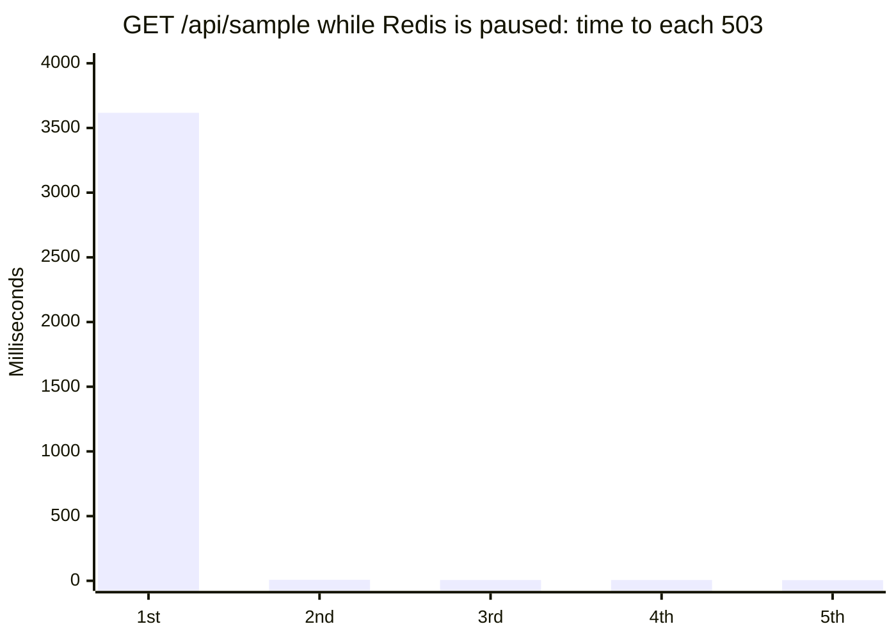

# Verification

What was run in this repository, at which revision, and what each run showed.
Planned cases are in each specification's test plan; this document holds
results only. A check that is not listed here was not run.

## Revision and environment

|              |                                                                                                                                                                                                                                                                                                                                                                                                                                                                                                                                                                                                                                                                                  |
| ------------ | -------------------------------------------------------------------------------------------------------------------------------------------------------------------------------------------------------------------------------------------------------------------------------------------------------------------------------------------------------------------------------------------------------------------------------------------------------------------------------------------------------------------------------------------------------------------------------------------------------------------------------------------------------------------------------- |
| Revision     | Tree `ff3d71fcbe045d57eebadf71bcd6949d5f5b0fc8`, which is `main` at commit `b3c7a70` with pull requests #21 and #22 applied, before this run was written into the record, for the first six commands and the Compose start below. The population check, the pause timing and the browser pass are from tree `6c0cf6ef3ab2a196f1099a594fa1229774af135a`, `main` at `8581c61` (pull request #16); since then the application source changed in four files: `apps/web/src/live/liveSession.ts` and `apps/api/src/users/seed-users.ts`, and, in class names, type annotations and a comment only, `apps/api/src/admin/admin.controller.ts` and `apps/api/src/users/user-registry.ts` |
| Date         | 2026-11-17                                                                                                                                                                                                                                                                                                                                                                                                                                                                                                                                                                                                                                                                       |
| Machine      | One laptop: Apple M3 Pro, 18 GB memory, macOS 26.2                                                                                                                                                                                                                                                                                                                                                                                                                                                                                                                                                                                                                               |
| Node.js, npm | 26.5.0, 11.17.0                                                                                                                                                                                                                                                                                                                                                                                                                                                                                                                                                                                                                                                                  |
| Docker       | 29.8.2                                                                                                                                                                                                                                                                                                                                                                                                                                                                                                                                                                                                                                                                           |
| Redis        | 8.10.3 (`redis:8-alpine`), one instance in Docker, used by nothing else during the runs                                                                                                                                                                                                                                                                                                                                                                                                                                                                                                                                                                                          |
| Browser      | Chromium 151.0.7922.34 driven by Playwright, headless, 1440 by 900 pixels                                                                                                                                                                                                                                                                                                                                                                                                                                                                                                                                                                                                        |

Runs made on the branch `dashboard-triage` name the tree they ran on, as
`git rev-parse HEAD^{tree}` printed it. The commits of that branch were
combined into three before its review, so each of those trees is a state of
the work as it went and not a commit of this repository.

## Automated checks

Commands as in the [README](../README.md#verification), from a fresh checkout
after `npm ci`, run one after another on a Redis server of their own. That
server listened on another free port than the README's 6380; nothing else
differed. Seven of these commands were repeated on 2026-11-18 after the
closest-first order was added; their newer results are under
[Closest-first order and row actions](#closest-first-order-and-row-actions),
and the table below keeps the full run. Six were run again on 2026-11-19 for
the change under [Held rows](#held-rows).

| Command                            | What it runs                                                                                                                                                                                           | Result                                                                                                                                                                                                                 |
| ---------------------------------- | ------------------------------------------------------------------------------------------------------------------------------------------------------------------------------------------------------ | ---------------------------------------------------------------------------------------------------------------------------------------------------------------------------------------------------------------------- |
| `npm run build`                    | The API and the dashboard build, each compiling the shared contract types it imports                                                                                                                   | Exit 0 in 6.1 s. Vite warns that the dashboard's JavaScript file is 966 kB (289 kB gzipped), above its 500 kB notice                                                                                                   |
| `npm run lint`                     | Type-aware lint of the API (explicit `any` is an error) and the dashboard                                                                                                                              | Exit 0 in 4.4 s, nothing reported                                                                                                                                                                                      |
| `npm test`                         | API: unit tests with the store mocked, controller tests over HTTP and Redis-client tests against a local TCP peer. Dashboard: component and hook tests in jsdom with a mocked socket. No Redis server. | Exit 0 in 24.9 s. API: 296 tests in 17 files passed. Dashboard: 128 tests in 14 files passed                                                                                                                           |
| `npm run check:contracts`          | The fixture data against the dashboard's own shape checks                                                                                                                                              | Exit 0, `fixtures consistent: 134 checks passed`                                                                                                                                                                       |
| `npm run test:integration`         | The built application over HTTP and Socket.IO against a real Redis                                                                                                                                     | Five runs in a row, each exit 0: 81 tests in 14 files passed, none skipped, in 29.1 to 30.4 s                                                                                                                          |
| `npm run check:two-process`        | Two API processes on one Redis: one quota, events and alerts relayed to each other's dashboards                                                                                                        | Three runs, each exit 0 in 3.8 to 3.9 s, with the output below and no API log line at error or warning level; 30 more runs in a row on tree `ca53c5b800efeffb5527152b8313ad09e7baf5f3` (pull request #20), each exit 0 |
| `npm run check:population`         | One API with 1000 and then 10000 registered users: list, filter and analytics reads                                                                                                                    | Three runs, each exit 0 in 9.7 to 10.4 s; figures under [Reads by number of users](#reads-by-number-of-users)                                                                                                          |
| `docker compose up --build --wait` | The image and Compose: both containers healthy                                                                                                                                                         | Exit 0 in 11.8 s, both services healthy; the page and `/api/health` answer 200 and a first sample request 200 with `x-count: 99`; the application runs as the user `node`                                              |

The integration runner prints totals and not one line per test. That a case
named below passed is concluded from 81 of 81 tests passing in every run with
none skipped.

Every line `npm run check:two-process` printed, apart from the API processes'
own logs and the line naming its Redis URL and ports, the same in all three
runs:

```
Both processes admitted against the same counter (99, 98 remaining)
200=100 429=100 other=0
One rate:limit_exceeded event, the same at the dashboards on both processes
Cross-process request event received
Cross-process reset event received
```

### Concurrent admission

One user, quota 100, 200 requests sent at once.

| Setup             | Admitted (200) | Rejected (429) | Other | Source                                                                                                                                                                                                                                                                 |
| ----------------- | -------------- | -------------- | ----- | ---------------------------------------------------------------------------------------------------------------------------------------------------------------------------------------------------------------------------------------------------------------------- |
| One API process   | 100            | 100            | 0     | `apps/api/test/concurrency.e2e-spec.ts`, "admits exactly 100 of 200 concurrent requests, each with its own x-count", in all five integration runs. It also asserts that the 100 `x-count` values are 0 to 99, each once, and that Redis holds 100 entries for the user |
| Two API processes | 100            | 100            | 0     | Printed by `npm run check:two-process` in all three runs; the requests alternate between the two processes, and the check asserts 100 entries in Redis                                                                                                                 |

### A Redis that stops answering

In the integration runs Redis is reached through a TCP relay that is either
stopped (connections refused) or hung (connections open, nothing forwarded).
The first failing answer must arrive in under 5 s and each later one in under
0.5 s; these bounds are constants of `apps/api/test/support/application.ts`.
Every case passed in all five runs.

| Case                                                                                                           | Asserted                                                                                                                                                                                                                                                                                                                 |
| -------------------------------------------------------------------------------------------------------------- | ------------------------------------------------------------------------------------------------------------------------------------------------------------------------------------------------------------------------------------------------------------------------------------------------------------------------ |
| `outage.e2e-spec.ts`, "answers 503 within a bound while Redis is stopped, then serves again without a restart" | With a sample request arriving every 200 ms, a sample request and an admin reset both answer 503 within the first bound, then three more rounds within the later bound, without `x-count`. After the relay is restored the user list answers 200 within 8 s, a sample request answers 200 and a reset leaves `used` at 0 |
| `outage.e2e-spec.ts`, the same case "while Redis is hung"                                                      | The same, with the hung relay                                                                                                                                                                                                                                                                                            |
| `health.e2e-spec.ts`, "answers 200 while Redis answers"                                                        | `GET /api/health` answers 200 `{"status":"ok"}` without a credential                                                                                                                                                                                                                                                     |
| `health.e2e-spec.ts`, "answers 503 while Redis is stopped, and 200 once it is back"                            | 503 with the message "Redis is not reachable.", and 200 again within 8 s                                                                                                                                                                                                                                                 |
| `health.e2e-spec.ts`, "answers 503 within the bound while Redis is hung, and 200 once it answers"              | The first 503 within the first bound, three more within the later bound, and 200 again within 8 s                                                                                                                                                                                                                        |

The same was timed once by hand on the Compose application:
`docker compose pause redis`, one request every 200 ms to each route, then
`docker compose unpause redis`.

| Route             | First 503 after the pause                                    | That request took | The next four 503s took | First 200 after the unpause |
| ----------------- | ------------------------------------------------------------ | ----------------- | ----------------------- | --------------------------- |
| `GET /api/sample` | 3.81 s, "The rate limit store did not answer.", no `x-count` | 3617 ms           | 8, 6, 6 and 5 ms        | 0.11 s                      |
| `GET /api/health` | 3.81 s, "Redis is not reachable."                            | 3640 ms           | 10, 7, 4 and 3 ms       | 0.11 s                      |



The first request waits until the client gives the connection up, which the
[platform specification](specs/platform.md#behavior) puts at about 4 s; the
ones after it are refused at once. Neither container restarted: the restart
count stayed 0 and the start time stayed the same for both.

### Reads by number of users

`npm run check:population`, three runs on 2026-11-18 at tree `5e7ea13`,
with the page ordered closest to the limit beside the others. Each figure is taken over
ten sequential requests to one admin route, timed in the script from sending
the request to the parsed JSON body, while one sample request every 50 ms goes
to the same API. It is the time an admin client waits on one machine, not
admission latency and not a load test. "Page" is
`GET /api/admin/users?page=10`, "filter" is `?status=OK&search=user`, which
matches every user and so reads them all, "closest" is `?sort=closest`, the
order the dashboard asks for by default, and "analytics" is
`GET /api/admin/analytics`. "Seed" is the time to register users 1 to N in the
script's own process; at 10000 it finds the first 1000 present and adds 9000.
"Redis memory" is `used_memory` of the whole test server after the reads, the
server's own baseline included.

| Run | Users | Seed     | Page, median / max | Filter, median / max | Closest, median / max | Analytics, median / max | Redis memory | Sample requests, all admitted |
| --- | ----- | -------- | ------------------ | -------------------- | --------------------- | ----------------------- | ------------ | ----------------------------- |
| 1   | 1000  | 48.5 ms  | 3.5 / 7.9 ms       | 17.4 / 19.8 ms       | 15.7 / 25.2 ms        | 14.4 / 15.1 ms          | 2,847,048 B  | 10                            |
| 1   | 10000 | 214.8 ms | 2.9 / 3.0 ms       | 143.4 / 190.4 ms     | 125.2 / 131.5 ms      | 130.8 / 213.2 ms        | 5,639,848 B  | 78                            |
| 2   | 1000  | 46.1 ms  | 3.4 / 6.6 ms       | 16.8 / 23.9 ms       | 15.6 / 20.2 ms        | 17.3 / 21.7 ms          | 2,844,112 B  | 11                            |
| 2   | 10000 | 230.9 ms | 3.7 / 3.8 ms       | 130.0 / 214.4 ms     | 131.4 / 181.4 ms      | 150.0 / 223.9 ms        | 5,639,392 B  | 83                            |
| 3   | 1000  | 42.9 ms  | 3.4 / 6.3 ms       | 14.6 / 18.7 ms       | 14.8 / 15.1 ms        | 13.7 / 19.0 ms          | 2,842,656 B  | 9                             |
| 3   | 10000 | 196.0 ms | 2.6 / 3.0 ms       | 129.8 / 136.9 ms     | 133.8 / 170.2 ms      | 166.0 / 196.0 ms        | 5,638,776 B  | 79                            |

An unfiltered page in ID order reads only its own rows and does not grow with
the number of users. A filtered page, a page ordered closest to the limit and
the analytics read every registered user and took eight to twelve times as
long at ten times the users. The first page in closest-first order, which
keeps 50 rows between batches, took what a filtered page took; a page far
down, which keeps more, was not timed. The medians are charted in the
[README](../README.md#verification). The dashboard asks for the closest-first
page and the analytics on every snapshot, every 10 seconds per open
dashboard: two reads of 125 to 166 ms each at 10000 users.

## In a browser

One pass in Chromium against the Compose application at
http://127.0.0.1:3000, started with `docker compose up --build --wait` and
then given 1000 users with `npm run seed:users -- --count 1000`, which printed
`{"processed":1000,"added":988,"total":1000}`. Each observation was compared
with the admin API's answer to the same question where one exists. A
screenshot of every step was looked at; two of them are in the README and the
others are not kept.

| #   | Done                                                                                                   | Observed                                                                                                                                                                                                                                                                                                    | Result                  |
| --- | ------------------------------------------------------------------------------------------------------ | ----------------------------------------------------------------------------------------------------------------------------------------------------------------------------------------------------------------------------------------------------------------------------------------------------------- | ----------------------- |
| 1   | Signed in with a wrong token, then with `demo-admin-token`, each with Enter                            | "The admin token was not accepted.", then the dashboard with "LIVE"                                                                                                                                                                                                                                         | Pass                    |
| 2   | Read the table                                                                                         | The columns User ID, Remaining / Total, Reset Time, Status and Last Request; 12 rows before seeding, as the API reports                                                                                                                                                                                     | Pass                    |
| 3   | Sent one request as `user-01` with `curl` while the page was open                                      | The row went from 99 / 100 to 98 / 100 with a new last-request time, without a reload                                                                                                                                                                                                                       | Pass                    |
| 4   | Ran `node scripts/traffic.mjs http://127.0.0.1:3000` for 10 s                                          | Three users at OK, one at Warning (8 / 100) and one at Exceeded (0 / 100); the notification "Limit exceeded: user-06", "Retry at 18:00:00 UTC" appeared 1.3 s after the traffic started and closed after 5 s                                                                                                | Pass                    |
| 5   | Searched `user-1`, `USER-05` and `nobody`; chose each status and each "Last active" option             | 3, 1 and 0 rows; every filter showed the rows the API returns for the same query                                                                                                                                                                                                                            | Pass                    |
| 6   | With 1000 users: page sizes 25 and 100, Next, Previous, Last and First; a request as a user on page 2  | "Page 1 of 20 · 1000 matching users" at the default 50, then 40 pages at 25 and 10 at 100; pages 3 and 40 equal the API's; the row on page 2 changed 0.02 s after the request                                                                                                                               | Pass                    |
| 7   | Opened a user, sent a request as that user, switched the history to "Past day"                         | Usage, limit, extra, remaining, reset time, last reset, last request and suspension; 100 recent requests, as the API returns; the new request at the top of the list after 0.05 s; the chart and its totals changed with the range. The totals line changes at the next history read, not on the live event | Pass                    |
| 8   | On one user: reset, limit 5, suspend for 5 minutes, 7 requests, resume, 1 request, 10 extra, 1 request | Each action showed on the page and in the API. While suspended all 7 requests were admitted with `x-count` 4, 3, 2, 1, 0, 0, 0; after resuming the next one was a 429 "Rate limit of 5 requests per hour exceeded. Try again at 18:00:00 UTC."; after the extra grant the next one was admitted             | Pass                    |
| 9   | Set the limit to `0`, `20000` and `1.5`; then paused Redis and pressed "Reset usage"                   | Each value refused with "Enter an integer from 1 to 10000." and no request sent. With Redis paused the action showed "The rate limit store did not answer." after 3.3 s and its button was usable again; the load errors cleared about 3 s after the unpause, and a reset then succeeded                    | Pass                    |
| 10  | Read the analytics cards and `GET /api/admin/analytics` before and after                               | Total users 1000, near limit 22%, three 429s today and the same five top users in both                                                                                                                                                                                                                      | Pass                    |
| 11  | `docker compose restart app` with the page open, then a request as `user-09`                           | "DISCONNECTED, RECONNECTING…" after 0.23 s, "LIVE" again after 1.12 s, and the row equal to the API's without a reload                                                                                                                                                                                      | Pass                    |
| 12  | Hid the tab                                                                                            | Not checked: see [Not verified](#not-verified)                                                                                                                                                                                                                                                              | Not checked             |
| 13  | Keyboard only                                                                                          | Signed in with Enter, chose a status filter with the arrow keys, opened a user with Enter, added 3 extra requests from the form (the API's `extra` went from 0 to 3); Escape closed the panel and returned focus to the user's button                                                                       | Pass                    |
| 14  | Read the browser console over the whole pass                                                           | The 401 of the refused token and the 503s of the deliberate pauses, as expected. One warning is unexplained: "WebSocket is closed before the connection is established", in the session that first signed in with a wrong token. The page worked normally afterwards                                        | One warning unexplained |

Two smaller observations. With the detail panel open at this window size the
panel covers the table's Status and Last Request columns, which is why the
README shows two pictures. The page summary reads "1 matching users" for a
single match, following the pattern the dashboard specification gives.

The other run modes of the [README](../README.md#run-it):

| Mode            | Done                                                                                                                                           | Observed                                                                                                                                                              | Result                   |
| --------------- | ---------------------------------------------------------------------------------------------------------------------------------------------- | --------------------------------------------------------------------------------------------------------------------------------------------------------------------- | ------------------------ |
| Development     | `docker compose up -d redis`, `cp .env.example .env`, `npm run dev`; signed in at http://localhost:5173; one request as `user-01` to port 3000 | 12 rows and "LIVE"; the row changed 0.06 s after the request; an empty console                                                                                        | Pass                     |
| Dashboard alone | `VITE_FIXTURES=1 npm run dev -w apps/web` with nothing on port 3000                                                                            | The token form, which any token passes; then 12 fixture rows at OK, Warning and Exceeded, the cards and "LIVE"; no request to `/api` or `/socket.io` left the browser | Pass                     |
| One origin      | Not run by hand                                                                                                                                | The integration file `one-origin.e2e-spec.ts` serves the built page, the API and the socket from one process                                                          | Not checked in a browser |

## Closest-first order and row actions

Run on 2026-11-18 on the machine of
[Revision and environment](#revision-and-environment), at tree `5e7ea13` of
the branch `dashboard-triage`, which holds the fixes of that branch's review,
on a Redis server of its own at port 6380. The commands and the browser
passes ran one after another, never together: the Socket.IO adapter's
channels are not separated by Redis database number, so a dashboard open
while the integration suite uses the same server shows that suite's events.
That was seen once, and that pass was thrown away and repeated.

| Command                     | Result                                                                                                         |
| --------------------------- | -------------------------------------------------------------------------------------------------------------- |
| `npm run build`             | Exit 0, with Vite's notice about the size of the dashboard's JavaScript file as before                         |
| `npm run lint`              | Exit 0, nothing reported                                                                                       |
| `npm test`                  | Exit 0. API: 306 tests in 17 files passed. Dashboard: 174 tests in 15 files passed                             |
| `npm run check:contracts`   | Exit 0, `fixtures consistent: 138 checks passed`                                                               |
| `npm run test:integration`  | Five runs in a row, each exit 0: 84 tests in 14 files passed, in 30 to 31 s                                    |
| `npm run check:two-process` | Three runs, each exit 0 in 3 to 4 s, printing the five lines shown under [Automated checks](#automated-checks) |
| `npm run check:population`  | Three runs, each exit 0; figures under [Reads by number of users](#reads-by-number-of-users)                   |

Not repeated: `docker compose up --build --wait` and the 14 browser items of
[In a browser](#in-a-browser). Those items describe the page before this
change: its "First" and "Last" paging buttons no longer exist, and the admin
actions of item 13 now stand above the history.

In Chromium at 1440 by 900 pixels, the built application
(`node apps/api/dist/main.js`, which also serves the built dashboard: the
"One origin" mode) on port 3040. Items 1 to 9 had 1000 users from
`npm run seed:users -- --count 1000` and the bursts of
`node scripts/traffic.mjs http://127.0.0.1:3040`, stopped before the pass so
that the figures stand still. Items 10 to 15 had a fresh store with the 12
demo users and one more whose ID has 64 characters, and sent requests between
the steps so that one user passed another. Each observation was compared with
the admin API's answer where one exists.

| #   | Done                                                                                                                                                      | Observed                                                                                                                                                                                                                                                           | Result |
| --- | --------------------------------------------------------------------------------------------------------------------------------------------------------- | ------------------------------------------------------------------------------------------------------------------------------------------------------------------------------------------------------------------------------------------------------------------ | ------ |
| 1   | Signed in and read the table                                                                                                                              | "Page 1 of 20 · 1000 matching users" and 50 rows; the first five users are user-06 (Exceeded, 0 / 100), user-05 (Warning, 8 / 100), user-04, user-03 and user-02, the order `GET /api/admin/users?sort=closest` returns                                            | Pass   |
| 2   | Read the Status choice                                                                                                                                    | "All 1000", "Exceeded 1", "Warning 1", "OK 998", as `statusCounts` of the analytics                                                                                                                                                                                | Pass   |
| 3   | Counted the rows with controls                                                                                                                            | Two: the Exceeded and the Warning row, each with "Add extra" and "Reset usage"                                                                                                                                                                                     | Pass   |
| 4   | "Next page", "Previous page", a search for `user-777`, the Status choice "Exceeded", "Users per page" 100                                                 | "Page 2 of 20 · 1000 matching users"; one row, user-777; one row, user-06; "Page 1 of 10 · 1000 matching users"                                                                                                                                                    | Pass   |
| 5   | "Add extra to user-06", then "Add extra" in the field                                                                                                     | The field "Extra requests" opened holding 50 with the focus in it. Afterwards the API reports total 150, remaining 50 and status OK, the row reads 50 / 150 and OK, has lost its controls and is still first; in the next pass, after a page read, it stood second | Pass   |
| 6   | Opened user-05                                                                                                                                            | The headings "Admin actions", "History" and "Recent requests" in that order; Escape closed the panel and returned focus to "user-05"                                                                                                                               | Pass   |
| 7   | With the table header scrolled out of view, paused Redis and pressed Enter on "Reset usage of user-05"                                                    | "user-05: The rate limit store did not answer." at the top of the window (0 to 56 px) while the header was 56 px above it; after the unpause the focus was on "Reset usage of user-05" again                                                                       | Pass   |
| 8   | Pressed Enter on "Reset usage of user-05" once more                                                                                                       | The row reads 100 / 100 and OK, the error is gone, and the focus is on the row's "user-05" button, as its controls no longer exist                                                                                                                                 | Pass   |
| 9   | Read the browser console over the passes                                                                                                                  | Empty, apart from the three 503s of the deliberate pause                                                                                                                                                                                                           | Pass   |
| 10  | By mouse only: opened user-03 by a click on its row, closed the panel with its close button, moved the pointer off the table; user-03 then passed user-02 | The focus was on "user-03" and was not keyboard focus (`:focus-visible` false); after the next page read the table showed user-03 first, as the API did                                                                                                            | Pass   |
| 11  | Rested the pointer on the first row while user-02 passed user-03                                                                                          | After the page read the API listed user-02 first; the table kept user-03 first and showed user-02's new values, 15 / 100; when the pointer left the table, user-02 stood first at once                                                                             | Pass   |
| 12  | Moved focus with Tab from the search field to the first row's ID while the third user passed both                                                         | Keyboard focus on "user-02"; after the page read the table kept its order; a second Tab, to the next row's ID, kept it too; a click on the page heading showed the API's order at once                                                                             | Pass   |
| 13  | Typed a search while the pointer rested on a row                                                                                                          | The rows of the new search in the API's order for it                                                                                                                                                                                                               | Pass   |
| 14  | Read the row and the Top users line of the user with the 64-character ID                                                                                  | In the table the ID wraps over three lines, the row is 65 px high beside 46 px, the counts and both times stay on one line and the badge reads "WARNING" in full; in Top users the ID stands in full over eight lines beside its bar and "95 / 100"                | Pass   |
| 15  | Entered 0 in that row's "Extra requests", then pressed "Dismiss"                                                                                          | "…: Enter an integer from 1 to 10000." with the user's ID as the table's error; gone after "Dismiss"                                                                                                                                                               | Pass   |

The dashboard alone (`VITE_FIXTURES=1`, port 5199), by the agents that wrote
the views. At tree `578e5ea`, before the review fixes: milestone steps 1 to
3 of the [dashboard specification](specs/dashboard.md#milestone) were seen as
written, and the measured contrast of every text and its background on the
new elements, the tinted rows and the outcome badges included, was at least
5.69 to 1; the fixes changed none of those colours. During the fixes: a row
hovered for 12 s, past a snapshot, kept the order, and an open "Extra
requests" field was still open after one.

Not checked for this change: any browser other than Chromium, where what
counts as keyboard focus and whether a removed element sends a blur may
differ; a touch screen or a pen; the page at a width below 1440 pixels; the
held order while focus moves between two controls, for a moment without
focus; a hold whose row leaves the page from under a resting pointer; the
held order with 1000 users under steady traffic; a closest-first page far
down the list, whose read keeps more rows; the dashboard at 10000 users,
where only the read times above were taken; and the Compose image.

## Held rows

Run on 2026-11-19 on the machine of
[Revision and environment](#revision-and-environment), at tree `7597ca3` of
the branch `dashboard-triage`: a hold keeps the users and places it began
with, and the row whose "Extra requests" field is open reads its user again.
The change is in the dashboard only; the API is as it was at tree `5e7ea13`. The directories `apps`, `packages` and
`scripts` of tree `7597ca3` are those of the commit that carries the change.

| Command                     | Result                                                                             |
| --------------------------- | ---------------------------------------------------------------------------------- |
| `npm run build`             | Exit 0                                                                             |
| `npm run lint`              | Exit 0, nothing reported                                                           |
| `npm test`                  | Exit 0. API: 306 tests in 17 files passed. Dashboard: 182 tests in 15 files passed |
| `npm run check:contracts`   | Exit 0, `fixtures consistent: 138 checks passed`                                   |
| `npm run test:integration`  | One run, exit 0: 84 tests in 14 files passed, in 32 s                              |
| `npm run check:two-process` | One run, exit 0, `200=100 429=100 other=0` among its five lines                    |

In a browser, by a second agent that did not write the change: desktop Chrome
157.0.8103.79, the built application from a clean export of that tree, each
run with an API and a Redis container of its own, the table filtered to
Warning. A, B, C and D are four users; each observation was compared with the
admin API's answer.

| #   | Done                                                                                                                                                               | Observed                                                                                                                                                                                                                                        | Result |
| --- | ------------------------------------------------------------------------------------------------------------------------------------------------------------------ | ----------------------------------------------------------------------------------------------------------------------------------------------------------------------------------------------------------------------------------------------- | ------ |
| 1   | Rested the pointer on "Reset usage" of B, the second row; A, the first, was reset elsewhere and left the page at the next read; clicked without moving the pointer | The table kept A, now OK, above B; the element at the pointer's coordinates was still B's "Reset usage"; the click sent `POST /api/admin/users/user-B/reset`; the API then reported B at 0 used and C still at 94; A went when the pointer left | Pass   |
| 2   | Opened "Add extra" of B and typed 17 without sending; B reached 100 used and left the page; another admin call granted B 50                                        | The field stayed open with 17 in it; the row beside it read 50 / 150 and OK                                                                                                                                                                     | Pass   |
| 3   | As 2, but the grant was made while the browser's connection to the application was cut                                                                             | "Disconnected" and 0 / 100 during the cut; once restored the browser read B's detail, showed "Live" and 50 / 150, OK, with 17 still typed, 0.35 s after the connection returned in this run                                                     | Pass   |
| 4   | With the pointer resting on B, D entered the server's page                                                                                                         | D was not listed through that read and the next; when the pointer left the table the rows were those of the last page read, C and D                                                                                                             | Pass   |

Before the change, at tree `365117b`, the same agent had seen the faults in
the same browser: in item 1 the click sent the reset of C, and in item 2 the
row beside the open field read 0 / 100 while a fresh tab read 50 / 150.

Not checked for this change: `npm run check:population`, the integration suite
and the two-process check more than once, the 15 browser items of
[Closest-first order and row actions](#closest-first-order-and-row-actions),
any browser other than Chrome, a touch screen or a pen, a hold with more than
four users or under steady traffic, a hold across a new hour, and a failed
detail read for an open field. In the screenshots of item 1 the columns
stand a few pixels further right once A's values have changed, as the table
sizes its columns by their content; the button stayed under the pointer, and
no check bounds that movement.

## Requirements

Each item of [the requirements](REQUIREMENTS.md) and where it is shown. "T"
is `npm test`, "I" is `npm run test:integration`, "2P" is
`npm run check:two-process`, "P" is `npm run check:population`, "B" is the
browser pass above.

Files are named without their directory: `*.spec.ts` under `apps/api/src`, `*.e2e-spec.ts` under `apps/api/test`, `*.test.ts(x)` under `apps/web/src`. A file shows that a case exists; the result of running it is in the tables above.

| Requirement                                                                    | Shown by                                                                                                                                                                                  | Scope, and what is not shown                                                        |
| ------------------------------------------------------------------------------ | ----------------------------------------------------------------------------------------------------------------------------------------------------------------------------------------- | ----------------------------------------------------------------------------------- |
| Objective: rate limiting as a NestJS interceptor, in a concurrent environment  | `rate-limit/rate-limit.interceptor.ts`; `rate-limit.interceptor.spec.ts` (T); `concurrency.e2e-spec.ts` (I)                                                                               |                                                                                     |
| Backend 1: external storage, by user ID and not IP or MAC                      | `user-token.guard.spec.ts`, `rate-limit.store.spec.ts` (T); `admission.e2e-spec.ts`, `registry.e2e-spec.ts` (I)                                                                           | The ID comes from the bearer token; no address is read                              |
| Backend 2: NestJS                                                              | `apps/api/package.json`, `app.module.ts`; the build                                                                                                                                       |                                                                                     |
| Backend 3: 100 per hour, tracked externally, reset every hour                  | `admission.e2e-spec.ts`, `expiry.e2e-spec.ts` (I); `rate-limit.interceptor.spec.ts`, `keys.spec.ts` (T); 2P                                                                               | A fixed UTC hour, not a rolling window                                              |
| Backend 4: `x-count` on each successful request                                | `admission.e2e-spec.ts` (I); `rate-limit.interceptor.spec.ts` (T)                                                                                                                         |                                                                                     |
| Backend 5: concurrency-proof                                                   | `concurrency.e2e-spec.ts`, `store-races.e2e-spec.ts` (I); 2P                                                                                                                              | Bounded runs with one and two processes on one machine                              |
| Backend 6: 429 with a message and the time to try again                        | `admission.e2e-spec.ts` (I); `rate-limit.interceptor.spec.ts` (T)                                                                                                                         | The body's retry time and `Retry-After`                                             |
| Backend 7: unit tests with a mock library for the store                        | `rate-limit.interceptor.spec.ts`, `rate-limit.store.spec.ts`, with `vitest-mock-extended` (T)                                                                                             |                                                                                     |
| Frontend: React or Angular, TypeScript, a UI library                           | `apps/web/package.json` and the lockfile; the build                                                                                                                                       | React, TypeScript and Mantine at the versions the lockfile pins                     |
| Core 1: live user table over WebSocket, `@nestjs/websockets`, both events      | `live-events.e2e-spec.ts`, `alerts.e2e-spec.ts`, `cross-process.e2e-spec.ts` (I); `App.test.tsx`, `assembled.test.tsx`, `live/useLiveUsers.test.tsx` (T); 2P; B                           |                                                                                     |
| Core 2: user detail: stats, recent requests, last reset, event stream, history | `read-model.e2e-spec.ts` (I); `features/dashboard.test.tsx`, `assembled.test.tsx` (T); B                                                                                                  | The event list holds requests, not admin actions                                    |
| Core 3: reset, custom limit, temporary suspension, extra requests              | `admin-behavior.e2e-spec.ts`, `admin-http.e2e-spec.ts`, `expiry.e2e-spec.ts` (I); `features/admin/AdminForms.test.tsx`, `features/dashboard.test.tsx` (T); B                              |                                                                                     |
| Core 4: search by user ID, status filter, last-active filter                   | `registry.e2e-spec.ts`, `read-model.e2e-spec.ts` (I); `user-reads.spec.ts`, `features/table/UsersTable.test.tsx`, `api/fixture-client.test.tsx` (T); B                                    | Exactly 90% is Warning                                                              |
| Core 5: total users, percent near the limit, today's 429s, top users           | `read-model.e2e-spec.ts`, `registry.e2e-spec.ts` (I); `analytics.spec.ts`, `features/dashboard.test.tsx` (T); B                                                                           |                                                                                     |
| Submission: `package.json` with dependencies and scripts                       | `npm ci`, `npm run build`, `npm run lint`, `npm test` from a fresh checkout                                                                                                               |                                                                                     |
| Submission: a ZIP file or a link to a GitHub repository                        | This repository                                                                                                                                                                           | Sending it is the owner's step and is not claimed here                              |
| Submission: commented code and good practices                                  | [Coding rules](CODING-RULES.md), enforced in part by lint                                                                                                                                 | A judgement for the reviewer; no test shows it                                      |
| Expectation: every significant decision backed by reasoning and trade-offs     | [Decisions](../README.md#decisions) in the README, which links the 26 decisions of the five specifications, each with its alternatives and cost                                           | Whether the reasoning convinces is the reviewer's judgement                         |
| Expectation: engineering thought process                                       | The specification-first trail: a specification commit before the code in each pull request, the test plans, the review fixes in the history, and this record                              | A judgement for the reviewer                                                        |
| Expectation: architecture                                                      | The decisions of the five specifications; the build; I; 2P                                                                                                                                |                                                                                     |
| Expectation: scalability                                                       | 2P; P; `registry.e2e-spec.ts` (I)                                                                                                                                                         | Two processes and 10000 users on one machine; filters and analytics read every user |
| Expectation: performance                                                       | `concurrency.e2e-spec.ts` ("answers another user within a second each while 1000 rejections arrive") (I); P                                                                               | No throughput or admission-latency figure was measured                              |
| Expectation: reliability                                                       | `redis.module.spec.ts`, `redis-io.adapter.spec.ts`, `health.controller.spec.ts` (T); `outage.e2e-spec.ts`, `health.e2e-spec.ts`, `cross-process.e2e-spec.ts` (I); the Compose pause above | One Redis; no failover, no restart with lost data                                   |
| Expectation: security                                                          | `config.spec.ts`, `user-token.guard.spec.ts`, `admin.controller.spec.ts` (T); `admin-http.e2e-spec.ts`, `registry.e2e-spec.ts`, `live-events.e2e-spec.ts` (I)                             | Demo tokens, no TLS                                                                 |
| Expectation: maintainability                                                   | The shared contract package, lint, `npm run check:contracts`, the coding rules                                                                                                            | A judgement for the reviewer                                                        |
| Expectation: ready for production                                              | Not shown                                                                                                                                                                                 | Demo credentials, one Redis without failover, no TLS, no load test                  |

## Pitfalls

Each item of [the pitfalls](PITFALLS.md) was checked against the code at
`cddeba2`: its guard was found, the fault was looked for, and where a small
edit could remove the guard, the edit was made and the item's check was run.
None of the 33 faults was found. P6 and P9 hold as their guards are worded and
no further: a rejection still costs two transactions, and requests during a
suspension grow the window's set until its key expires
([rate limiting](specs/rate-limiting.md#limits)). Two defects that the list
did not name were found and fixed:

- The dashboard dropped a `rate:limit_exceeded` alert when a snapshot holding
  the same version of the row arrived before the event (pull request #19).
  It was reproduced in the dashboard's tests, not against a running API.
- Two API processes started together on an empty Redis could each refuse the
  `DEMO_USERS` the other had just registered, and one stopped.
  `npm run check:two-process` failed 5 times in 30 before the fix and 0 times
  in 30 after it (pull request #20). The three passing runs recorded earlier
  were too few to show it.

Eight checks passed with their guard removed (P8, P9, P16, P18, P21, P25, P26
and P28). Pull request #19 added an assertion to each, and each was seen to
fail without the guard.

What the checks do not show:

- P5: only the mocked-store test notices an expiry set outside the
  transaction.
- P7: the latency case notices a lock held 50 ms for each request, not one
  held 10 ms.
- P22: two checks drop a late 401, and each hides the removal of the other.
- P31 and P32 are rules for people; nothing automated enforces them.
- P33: no automated check of contrast. Measured once by hand in Chromium, the
  status badges had ratios of 6.39 to 11.28 against a minimum of 4.5.

## Not verified

- A hidden tab in a real browser. Three ways of hiding the page (another tab
  in front, headless and with a window, and a minimized window) left
  `document.visibilityState` at "visible", so the pause while hidden and the
  read on becoming visible were not observed. They are covered only in jsdom,
  by `live/useLiveUsers.test.tsx`, "ticks every 10 seconds while visible,
  pauses while hidden, and reconciles on visibility".
- The "One origin" run mode in a browser, and the `npm run demo:traffic`
  alias: the traffic was sent with `node scripts/traffic.mjs` and a base URL.
- A request sent in the instant the API process was down during its restart.
  The request of item 11 went out after the API answered again and before the
  page had reconnected.
- "Last 24 hours" against "Last hour" in the browser: all activity lay within
  the hour, so both showed the same users.
- The cause of the WebSocket warning of item 14.
- Any browser other than Chromium.
- Sustained load, more than one host, TLS, a Redis failover, and the wait on
  `SIGTERM` of the platform specification.
