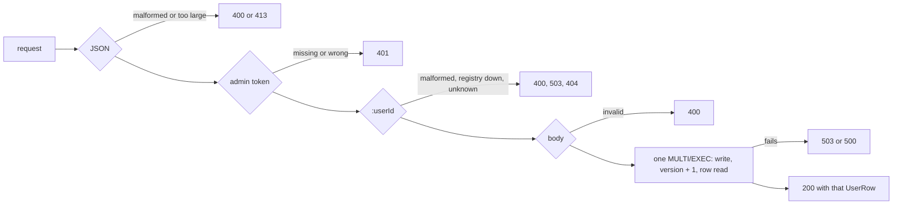

# Admin API

## Scope

The admin actions, the paged user list, detail, history and analytics. Answers
(Core features 1–5; Backend 5; Backend 7; Expectation: security, reliability,
scalability, performance).

## Behavior

1. **Checks first.** A refused request changes and emits nothing. In order:
   malformed JSON (400) or an oversized body (413) at the parser; the
   credential (401, [platform](platform.md#behavior)); on a user route, a
   malformed ID (400), an unreadable registry (503), an unregistered ID
   (404); only then an invalid body or query value (400), so an unknown user
   is 404 whatever its body. (Expectation: security; [P16])
2. **Bounds. Interpretation:** "Adjust limit (custom value)" and "temporarily"
   give no bounds. A body holds exactly one integer: `limit` 1–10000,
   `minutes` 1–1440 or `amount` 1–10000. History `range` is required, `hour`
   or `day`. (Core feature 3; Expectation: security; [P16])
3. **Reset. Interpretation:** "Reset limit" resets usage, not the limit: it
   clears the window's usage and grant, keeps limit, suspension and history,
   and stamps the last reset. (Core feature 3; [P14])
4. **Limit.** A custom limit is the base limit until changed. Usage and grant
   stay, so a spent cap rejects the next request unless throttling is
   suspended. (Core feature 3)
5. **Suspension. Interpretation:** "Suspend or unlock throttling temporarily"
   needs an end, now plus `minutes`, that admission compares with its own
   clock, so no job ends it; over-cap requests are admitted and counted.
   Unlock ends it early. (Core feature 3; [P12])
6. **Extra. Interpretation:** "Add extra requests within current window"
   raises this UTC hour's cap by `amount`; grants add up, leave usage alone
   and end at the hour. (Core feature 3; [P13])
7. **Settled, then answered.** A successful action answers 200 with the
   `UserRow` of its transaction; [live updates](live-updates.md#behavior)
   define its event and alert re-arm. An unavailable store is 503; a Redis
   error reply or other defect is 500. No retry: a failed or lost reply does
   not prove nothing was written. (Expectation: reliability; [P15]; [P17])
8. **List, detail, history.** A list page holds rows in the order rule 10
   gives, by default plain string order of the ID; detail adds up to 100 requests of the last 24 hours, newest first,
   ties by request ID. **Interpretation:** "short activity history (past
   hour/day)" is 60 minute or 24 UTC-hour buckets, oldest first, the current
   one included, empty ones zero. (Core feature 1; Core feature 2)
9. **Analytics** count every registered user, whatever the list shows.
   **Interpretation:** "% near limit" is the share of users with counted
   requests this window at Warning or Exceeded, rounded to the nearest
   integer, 0 when none; "429 count today" counts the UTC day; "Top users"
   are up to five active users by usage, highest first, then by ID. Usage is
   the row's count for this window, so a reset takes a user's earlier
   requests out of the ranking. **Addition:** `statusCounts` gives the number
   of registered users at each status, idle users counted as OK, so the three
   add up to the total. (Core feature 5; [P4])
10. **List query.** In plain decimal digits, `page` 1 (default) to
    ⌊(2^53 − 1) / 100⌋, so the offset stays exact, and `pageSize` 1–100
    (default 50); `search` up to 64 characters (default empty), a
    case-insensitive substring of the ID; `status` `OK`, `Warning` or
    `Exceeded`; `active` `5m`, `1h` or `24h`: a last request at or after the
    read's start minus that period. Both default to `any`; a user who never
    called matches only `any`. **Addition:** `sort` is `id` (default, plain
    string order of the ID) or `closest`: the larger share of its cap used
    comes first (`used / total`, compared as whole numbers, so every Exceeded
    row precedes every Warning row and those every OK row), equal shares in
    string order of the ID. An unknown, repeated or out-of-range field is
    400. Filters apply to every registered user, then the order, then the
    page is cut; `total` counts every match; a page past the last is empty.
    (Core feature 4; Expectation: security; [P16])
11. **Reads in batches.** An unfiltered page in ID order reads only its IDs
    and rows. A filtered page, a page sorted `closest` and the analytics read
    every user in ID order, a batch per transaction: each row is consistent
    with its version, the whole is not one snapshot. A page sorted `closest`
    keeps only the rows that can still stand on the page or before it: after
    each batch it orders what it holds and cuts it at the page's end. A read stops at the highest registered ID, in string order,
    that existed when it began; a user registered meanwhile is read only if
    its ID sorts after the batches already read and not after that ID, so the
    read cannot be extended. Its memory is a batch and a page, or for
    `closest` a batch and the rows up to the page's end. `startedAt` and
    `completedAt` give its interval.
    (Expectation: performance; Expectation: reliability; [P9])

Rules 1 and 7 for an action; an unlabelled arrow is the check passing:

## Interface

| Route under `/api/admin`; admin bearer token | Body | Answer | Errors |
| --- | --- | --- | --- |
| `GET /users?page=&pageSize=&search=&status=&active=&sort=` | none | `UsersPage` | 400 401 500 503 |
| `GET /users/:userId` | none | `UserDetail` | 400 401 404 500 503 |
| `GET /users/:userId/history?range=` | none | `HistoryBucket[]` | 400 401 404 500 503 |
| `GET /analytics` | none | `Analytics` | 401 500 503 |
| `POST /users/:userId/reset`, `DELETE /users/:userId/suspension` | none | `UserRow` | 400 401 404 500 503 |
| `PUT /users/:userId/limit`, `POST /users/:userId/suspension`, `POST /users/:userId/extra` | `SetLimitBody`, `SuspendBody`, `ExtraBody` | `UserRow` | 400 401 404 413 500 503 |

Storage: the keys of [rate limiting](rate-limiting.md#interface) and of
[platform](platform.md#interface).

## Decisions

### Admin writes and admission

Asked: concurrency-proof limiting (Backend 5) with controls acting mid-window.
Each action is one `MULTI`/`EXEC` on admission's instance, ending in a version
increment and a row read, so the returned row shows the action at its place in
that order. `WATCH` with retry costs round trips, a lock can outlive its
holder, scripts add a language. Cost: the write also queues the row read.

### Usage, limit and grant apart

These values have different lifetimes, so each has its key; admission and
admin reads share keys and row builder. One counter could keep an expired
grant or erase usage when a limit changes ([P13]). Cost: five commands per
row read.

### Numbered pages, filtered by reading in batches

Asked: a live table with search and filters (Core features 1, 4) that scales.
Sending every row grows each response and dashboard with the population, so
the server cuts a page. Status and last activity change with every request and
every hour without a write, so an index on them would burden admission and
need hourly repair; reading rows in ID order, a batch at a time, leaves
admission alone. Alternatives: a cursor (no "page 3 of 20"); filtering in the
browser (every row sent); per-status sorted sets (that upkeep). Cost: filtered
pages and analytics take time that grows with the population. Cases:
`user-reads.spec.ts`, `registry.e2e-spec.ts`.

### Closest to the limit first, sorted on every read

Asked: a table an admin can act from (Core features 1, 3). In ID order the
users at their limit are scattered over the pages, so the list can put them
first. The share of the cap used changes with every request, every limit or
grant and every hour, so the order is computed from the rows of one read and
kept nowhere. Alternatives: a sorted set kept by admission (a write on every
request, hourly repair, a re-score on every limit change); sorting in the
browser (orders one page, not the population); making it the only order (the
cheap ID page is lost). Cost: such a page reads every user, so its time grows with the
population, and it orders the rows up to the page's end again after each
batch, so a page far down costs more than the first;
`sort=id` keeps the cheap read. Cases: `user-reads.spec.ts`,
`registry.e2e-spec.ts`.

## Test plan

Mocked store (`vitest-mock-extended`, the test sets the time), in
`apps/api/src/`:
- `admin/admin.controller.spec.ts`: check order; a refusal reaches neither
  store nor event; the answer waits for the write; 503 for an outage, 500 for
  a defect; list-query refusals.
- `admin/user-reads.spec.ts`: an unfiltered page reads only its IDs; filters
  before the cut; `total`; past the end; analytics over every batch;
  `closest` orders across batches by share, not by count, ties by ID, after
  the filters and before the cut; a later batch's rows first, a page across
  two batches, and no more rows kept than the page's depth.
- `admin/analytics.spec.ts`: near-limit share, ranking with ties by ID, idle
  zero, rows added in batches, status counts adding up to the total.
- `rate-limit/rate-limit.store.spec.ts`: what each action writes; version and
  row read in its transaction; history buckets.

Real store, in `apps/api/test/` (run as in
[rate limiting](rate-limiting.md#test-plan)):
- `admin-behavior.e2e-spec.ts`: reset, limit, grant and suspension as in
  rules 3–6.
- `admin-http.e2e-spec.ts`: bad input changes nothing; an unknown user with
  an invalid value is 404 and writes nothing; an oversized body to a route
  with a body is 413 with the `ApiError` shape; a Redis error reply from each
  of the five actions is 500, not 503; 401 on every route, and the socket's
  connection refused with "Unauthorized"; an ID with uppercase, `_` and `-`
  survives ([P11]).
- `read-model.e2e-spec.ts`: snapshot, detail, `x-count` and analytics agree;
  top users; histories across the hour, zero-filled; 100 recent requests kept.
- `registry.e2e-spec.ts`: first, middle, last and past-the-end pages of 10001
  users; filters and analytics over every user; a batched read ends at the
  last ID of its start; bad queries are 400; `closest` brings the users at
  their limit from the end of the ID order to the first page.

## Milestone

With a fresh Redis (`docker compose up -d redis`), `cp .env.example .env` and
`npm run start:dev -w apps/api` running, in another shell set
`ADMIN='Authorization: Bearer demo-admin-token'`,
`JSON='Content-Type: application/json'`,
`API=http://localhost:3000/api/admin` and `USER7=$API/users/user-07`, then
run in order:

| Step | Commands | Expect, in turn |
| --- | --- | --- |
| 1 Reset, lower | `curl -s -X POST -H "$ADMIN" $USER7/reset`; `curl -s -X PUT -H "$ADMIN" -H "$JSON" -d '{"limit":2}' $USER7/limit` | `"used":0`, `"limit":100`, `"status":"OK"`; `"limit":2`, `"total":2`, `"remaining":2` |
| 2 Use the quota | `for n in 1 2 3; do curl -s -o /dev/null -w '%{http_code} ' -H 'Authorization: Bearer demo-token-07' http://localhost:3000/api/sample; done` | `200 200 429` |
| 3 Detail, history | `curl -s -H "$ADMIN" $USER7`; `curl -s -H "$ADMIN" "$USER7/history?range=hour"`; the same with `range=day` | `"used":2`, `"remaining":0`, `"status":"Exceeded"`, three `recentRequests`, `"outcome":"denied"` first, then two `"allowed"`; 60 buckets adding up to `"allowed":2` and `"denied":1`; 24 buckets |
| 4 Analytics, order | `curl -s -H "$ADMIN" $API/analytics`; `curl -s -H "$ADMIN" "$API/users?sort=closest&pageSize=2"` | `"totalUsers":12`, `"activeUsers":1`, `"nearLimitPercent":100`, `"denied429Today":1`, `"topUsers":[{"userId":"user-07","used":2,"total":2}]`, `"statusCounts":{"OK":11,"Warning":0,"Exceeded":1}`; rows `user-07`, then `user-01` |
| 5 Grant | `curl -s -X POST -H "$ADMIN" -H "$JSON" -d '{"amount":1}' $USER7/extra` | `"extra":1`, `"total":3`, `"remaining":1`, `"used":2` |
| 6 Suspend, unlock, reset | `curl -s -X POST -H "$ADMIN" -H "$JSON" -d '{"minutes":5}' $USER7/suspension`; `curl -s -X DELETE -H "$ADMIN" $USER7/suspension`; `curl -s -X POST -H "$ADMIN" $USER7/reset` | `"suspendedUntil"` five minutes ahead; `"suspendedUntil":null`; `"used":0`, `"extra":0`, `"limit":2` |
| 7 Refusals | `curl -s -w ' %{http_code}\n' -X PUT -H "$ADMIN" -H "$JSON" -d '{"limit":1.5}' $USER7/limit`; `curl -s -w ' %{http_code}\n' -X POST -H "$ADMIN" $API/users/nobody/reset`; `curl -s -w ' %{http_code}\n' $API/users`; `curl -s -w ' %{http_code}\n' -H "$ADMIN" "$API/users?pageSize=101"` | `limit must be an integer number` 400; `Unknown user.` 404; `A valid admin token is required.` 401; `pageSize must not be greater than 100` 400 |
| 8 Page, filter | `curl -s -H "$ADMIN" "$API/users?page=2&pageSize=5"`; `curl -s -H "$ADMIN" "$API/users?search=USER-0&active=1h"`; `curl -s -H "$ADMIN" "$API/users?search=USER-0"` | `"total":12`, `"page":2`, rows `user-06` to `user-10`; `"total":1`, the row of `user-07`; `"total":9` |

## Limits

Mocked cases check the commands queued; the milestone runs one API process
without concurrent writes. History and counters are recorded apart from
admission, and analytics reads rows and the daily count in separate
transactions. Only the list refuses unknown query fields; other routes ignore
those they do not read. The time of a filtered page, of a page sorted
`closest` and of analytics grows with the population, unbounded; a page sorted
`closest` holds the rows up to its end and orders them after every batch, so
its memory and that work grow with the page number; `npm run check:population` measures the times on one
machine only.

[P4]: ../PITFALLS.md#p4-a-near-limit-figure-that-drops-when-users-get-blocked
[P9]: ../PITFALLS.md#p9-storing-something-without-a-bound
[P11]: ../PITFALLS.md#p11-a-user-id-that-is-not-one-plain-string
[P12]: ../PITFALLS.md#p12-a-temporary-suspension-that-never-ends
[P13]: ../PITFALLS.md#p13-usage-base-limit-and-grant-in-one-number
[P14]: ../PITFALLS.md#p14-a-reset-that-resets-the-policy-and-not-the-usage
[P15]: ../PITFALLS.md#p15-answering-before-the-write-has-settled
[P16]: ../PITFALLS.md#p16-admin-input-that-reaches-the-store-unchecked
[P17]: ../PITFALLS.md#p17-retrying-an-admin-action-automatically
