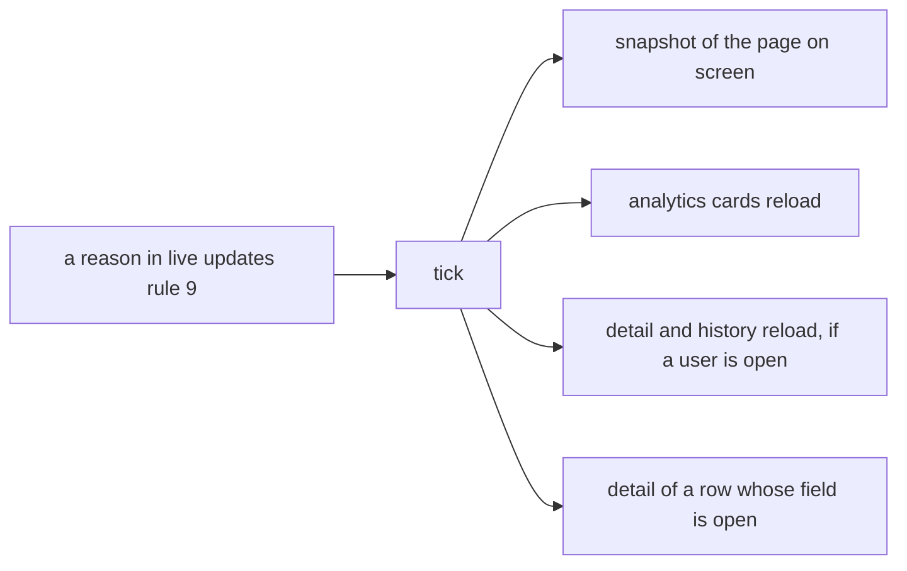

# Dashboard

## Scope

The admin page in the browser: session, API client with shape checks, live user
state, the fixture mode that runs it without an API, and the header that shows
the connection. It applies, and does not define,
[rate limiting](rate-limiting.md#behavior), [admin API](admin-api.md#behavior)
and [live updates](live-updates.md#behavior).

## Behavior

1. **Session.** A field labelled "Admin token", described as demo
   authentication, comes first; nothing is requested before a token is entered.
   The token stays in `sessionStorage` (memory if blocked) until the tab closes;
   no sign-out. A 401 or a refused handshake forgets it and returns to the field
   with "The admin token was not accepted." (Expectation: security)
2. **Requests.** Same origin, bearer token, 10-second limit, never repeated by
   the page ([P17]). A cancelled request is silent; any other failure shows a
   message. A response, event or 401 arriving after its session ended changes
   nothing ([P22]). (Expectation: reliability; Expectation: security)
3. **Shape checks.** A response or socket event that does not match its
   `packages/contracts` type is not used: a bad response fails with "The server
   returned an invalid response."; a bad event is ignored whole, with no row,
   recent request, alert or update time. The browser never computes remaining,
   total or status ([P3]). (Expectation: reliability; Expectation: security)
4. **Live state.** Rows, socket and snapshots are held and ordered as
   [live updates](live-updates.md#behavior) defines ([P21]). The header shows
   "Connecting…", "Live" or "Disconnected, reconnecting…" and, apart, "Last
   update HH:MM:SS UTC" or "No update yet" ([P20]). Every well-formed
   `rate:limit_exceeded` shows a red notification, "Limit exceeded: <id>", with
   "Retry at HH:MM:SS UTC", for 5 seconds; at most 3 show at once, the rest
   wait. (Core feature 1; Expectation: reliability)
5. **Fixture mode.** With `VITE_FIXTURES=1` in development no API is needed: any
   token opens the page, time stands at 10:42:00 UTC, data answers after 150 ms,
   a stand-in socket connects, sends `rate:update` at 2 and 4 s and
   `rate:limit_exceeded` at 6 s, and actions only raise a version. Its 12 rows
   are filtered, ordered and paged as the [admin API](admin-api.md#behavior)
   does, and its status counts match them. A
   production build holds none of it; `npm run check:contracts` fails if the
   data breaks its rules. (Expectation: maintainability)
6. **Table.** Exactly the headers User ID, Remaining / Total, Reset Time,
   Status and Last Request ([P1]), then "Actions" for the row controls of rule
   9; the server's values, minutes to reset ("11:00:00 UTC (18m)"), Status as
   a coloured badge carrying its text ([P33]), a suspension note, "Never" for
   no request; a long ID wraps and the other cells keep their one line;
   "Loading users…", an error over held rows, "No users match the
   filters." Beside Remaining / Total a bar shows the share used, drawn from
   the row's `used` and `total` and coloured by its status; a Warning or
   Exceeded row is tinted in that colour, its text still at 4.5:1 or more.
   **Addition:** "Sort" is "Closest to limit" (default) or "User ID", the
   orders of [admin API rule 10](admin-api.md#behavior). Rows stand in the
   order of the last page read: an event changes a row's values in place and
   never moves it; the next read orders them again. While the pointer is over
   a row, the keyboard focus is in a row or a row's field is open, the rows
   are held, so a control does not shift under a click: the users shown and
   their places stay as they were when the hold began. Their values still
   change, a user who left the page keeps the row, and a user new to the page
   waits; the page last read shows when the hold ends. A changed search,
   filter, order, page or page size is never held. **Interpretation** of
   "Live User Table: Displays" for a population of any size: the table shows
   the page the server cut and, below
   it, "Users per page" 25, 50 (default) or 100, "Previous page" and "Next
   page" buttons, "Page P of N · T matching users" and the time of the read,
   so every user is reachable by page, search or order. Next page stays
   disabled until the page answers. A changed filter, order or page size
   starts at page 1; a refresh that leaves the page past the last returns to
   page 1. (Core feature 1; Expectation: scalability)
7. **Search and filters.** "Search user ID" (case-insensitive substring, at most
   64 characters, as the API refuses longer), "Status" (one of All, Exceeded,
   Warning and OK) and "Last active" combine and are applied by the server to
   every registered user before the page is cut. The Status filter uses the
   server's status, which reads "Warning >= 90%, OK <= 90%" as
   [rate limiting rule 6](rate-limiting.md#behavior) defines. **Addition:**
   each Status choice shows its number of users from the analytics read (All:
   the total): every registered user, whatever the search and Last active
   say, as old as that read. Without a loaded analytics read the choices show
   no number and still filter ([P23]). **Interpretation** of "last active
   time": Any time, Last 5 minutes, Last hour or Last 24 hours before the
   server's read, against Last Request; a user who never called matches only
   Any time. A row keeps updating from events even when it stops matching,
   until the next page read, or until the end of a hold of rule 6 that keeps
   it. (Core feature 4)
8. **User detail.** An ID is a button opening a panel, and a click elsewhere
   on its row opens it too. From the top: the live row (status badge, the bar,
   "U used of T · R remaining" and the labelled values Limit, Extra, Reset,
   Last reset, Last request and Suspension, "Until HH:MM:SS UTC" or "Not
   suspended"); the admin controls of rule 9; the past hour or day as totals
   and a chart; recent requests, each outcome a badge carrying its word.
   Closing returns focus to the ID button. **Interpretation** of "Real-time
   event stream for that user": every dashboard receives every event
   ([live updates](live-updates.md#behavior)) and the panel filters them by
   `userId`; its list gains at once the request an accepted event of that user
   carries, merged by ID, within 24 hours, newest 100. It lists requests, not
   admin actions: an action changes the row and adds no entry. (Core feature 2)
9. **Admin controls.** In the panel: Reset usage, Set limit, Suspend, Resume
   throttling and Add extra, as in [admin API](admin-api.md#behavior).
   **Addition:** a Warning or Exceeded row of the table carries "Reset usage"
   and "Add extra", each named with the user's ID; Add extra opens a field
   "Extra requests" that holds 50 until changed, and the row keeps its
   controls while that field is open, also once it is OK. While the field is
   open its user's detail is read, at once and on every tick of rule 11, and
   its row applied as [live updates rule 7](live-updates.md#behavior) orders,
   so the values beside the field are as new as that read, also after a
   reconnect and once the user has left the page; the number typed stays. A
   number outside its range shows "Enter an integer from 1 to N." and sends
   nothing. The panel and the
   table each run one action at a time; the returned row is applied as live
   updates orders. A failure keeps the typed input, shows the error and asks
   for one fresh read; nothing is sent again ([P17]). The panel has one error
   shared by its controls, and the table one for its row controls that names
   the user: it stays until the next action of its place starts, an invalid
   entry in a field of that place replaces it, or the panel closes. The
   table's error stays in view while the page scrolls and has a "Dismiss"
   button. (Core feature 3)
10. **Analytics.** Four cards, Total users, Near limit, 429 today and Top users
    ("By requests this hour"), load apart from the table, count every registered
    user whatever the table shows, and give the time of their read. Near limit
    prints its definition: users active this hour at 90% or more, exceeded
    included ([P4]). Each Top users line holds the ID in full, wrapped when
    long, a bar of the share used, in one colour as a top user carries no status, and
    "used / total". The read also feeds the Status counts of rule 7. (Core
    feature 5)
11. **Panels load alone.** Detail, history, cards and the detail of a row
    whose field is open (rule 9) reload on every tick: each time a snapshot is
    requested for a reason
    [live updates rule 9](live-updates.md#behavior) lists; a new page or filter
    reloads the table only. Each keeps its last data and error until a load
    succeeds; a new key (another user or range) clears the old data and drops
    its late result ([P22]); one failing leaves the others working ([P23]).
    (Expectation: reliability)

## Interface

Consumes the routes of [admin API](admin-api.md#interface), the events of
[live updates](live-updates.md#interface) and `packages/contracts` types. Vite
serves port 5173 and forwards `/api` and `/socket.io` to the API, so calls are
relative; the API serves the built page on its own origin
([platform](platform.md#behavior) rule 9). Defines the `sessionStorage` key
`adminToken` and `VITE_FIXTURES` (development server only; `1` selects
fixtures).

## Decisions

### UI library: Mantine

One family covers forms, alerts and notifications. MUI, Ant Design, shadcn/ui
and Chakra were compared from general knowledge. Cost: every screen is written
against its components and styles, so replacing the library means rewriting the
views.

### Shape checks written by hand

`packages/contracts` holds types only, so a schema library adds a dependency and
a second definition of every payload; the guards in `api/validation.ts` restate
them too, more cheaply. Cost: a field a guard omits goes unnoticed, relations
(remaining against total) are unchecked, and the compiler compares only a
guard's lists of union members with its type.

### Live state in one hook, no state library

Events and snapshots arrive in any order, so `useLiveUsers` starts one session
(`live/liveSession.ts`) that owns rows and the snapshot queue; a query library
would not order them and adds a dependency. Cost: queueing, cancelling and
merging snapshot reads in order are code of this repository to maintain and
test.

### Held rows keep their users

Rule 6 holds the rows so that a control does not shift under a click, and a
reset cannot be undone. So a hold keeps the users and the places it began
with; the table names those users to the live session, which keeps their rows
and applies their events ([live updates rule 13](live-updates.md#behavior));
users new to the page wait for its end. Alternatives: drop a row that left the
page, which moves every row below it up under a resting pointer, so that a
click on "Reset usage" reaches another user; keep those rows and still add new
ones below, where the table grows with every read while the pointer rests; a
confirmation before a reset, one more step for every action; read every held
user again on each tick, up to a page of detail reads per refresh. Cost:
during a hold a user newly at the limit is not listed and the footer can
differ from the rows; a held row off the page is as new as its last event,
except the one whose field is open (rule 9). Cases:
`features/table/UsersTable.test.tsx`, `live/useLiveUsers.test.tsx`.

### Fixture mode

Screens had to be reviewable without Redis: fixtures sit behind a
development-only import, with no mock server. Cost: data can drift, hence
`fixtures/check.ts`.

## Test plan

Vitest in jsdom (`npm test -w apps/web`), paths under `apps/web/src/`:

- `api/client.test.ts`: bearer token, encoded IDs, each route's method, path and
  body; a 401 reported once, a late one dropped; malformed body; network
  failure; timeout.
- `api/useSession.test.tsx`: an old token's late responses, a 401 included, are
  inert; StrictMode; refusal ends the session first; an action 401.
- `api/fixture-client.test.tsx`: pinned time; versions rise; cancelling stops a
  request; the stand-in socket sends once; filters and plain string order;
  filters apply before the page is cut; "closest" order by share with a tie
  by ID.
- `api/usersQuery.test.ts`: closest first unless asked otherwise; two queries
  that differ only in their order are told apart.
- `live/useLiveUsers.test.tsx`: a malformed event ignored whole. Its ordering,
  snapshot and listener cases, with `live/rows.test.ts`, belong to
  [live updates](live-updates.md#test-plan).
- `lib/latestRequests.test.ts`: last copy wins, newest first, cap of 100.
  `lib/useRequest.test.tsx`: a new key clears and cancels; coalescing; data and
  error kept during a reload; A, B, A.
- `App.test.tsx` (Socket.IO mocked): token first; handshake on its own origin;
  "Loading users…"; the five headers and Actions; refusal; token kept, or in memory when storage
  is blocked.
- `features/dashboard.test.tsx`: failed snapshot; 24-hour merge; history failure
  isolated; old detail dropped; failed and late actions; invalid input never
  sent; analytics definitions; "shows the user's last reset time in the detail
  panel"; the controls stand before the history.
- `features/table/UsersTable.test.tsx`: search, Status and Last active narrow
  the rows and start at page 1; Status counts, and none while analytics is
  missing; "Closest to limit" asked first, "User ID" on choice, either from
  page 1; page buttons and "Users per page"; past the last page returns to
  page 1, with "No users match the filters."; an event leaves a row in its
  place; row controls on Warning and Exceeded rows only; a row's Add extra
  sends 50, or the number typed, for that user; a failed row action shows its
  error with the user's ID, once sent, and "Dismiss" closes it; a click on a
  row opens its panel and focuses its ID without scrolling; the rows held
  under the pointer, under focus and for a row with an open field: a row whose
  user left the page stays, so the control at a place is still the same
  user's, a user new to the page shows when the hold ends, and nothing is
  held across a changed order; the held users are named to the live session,
  and none once the hold ends; an open field reads its user's detail at once
  and on every tick, applies its row and keeps the number typed.
- `features/admin/AdminForms.test.tsx`: numeric bodies; Resume throttling; one
  action at a time. `features/analytics/AnalyticsCards.test.tsx`: a timeout
  stays shown until recovery; a 64-character ID in Top users in full.
- `assembled.test.tsx`: focus after closing; exceeded event announced; an action
  keeps its row; a failed action's error stays with its panel; analytics failure
  isolated; connection changes announced.
- `fixture-screen.test.tsx`: the fixture screen, and one reload of table,
  detail, history and cards per tick. `fixtures/check.ts` runs as
  `npm run check:contracts`.
- Not covered: charts, tints, "Past day", Last hour, Last 24 hours,
  "Never", a failed detail load, the detail panel's suspension text, the
  Total users and 429 values, the notification lifetime and limit.

## Milestone

`npm run check:contracts` ends `fixtures consistent: <n> checks passed`;
`npm test -w apps/web` reports no failure. Then:

1. `VITE_FIXTURES=1 npm run dev -w apps/web`, open http://localhost:5173, enter
   any token, press "Open dashboard": "Live"; within the first 10 s "Last
   update" reads 10:42:00 UTC, then 10:42:01, :02 and :03 at 2, 4 and 6 s, and
   at 6 s "Limit exceeded: user-05" and "Retry at 11:00:00 UTC" show for 5 s.
   The snapshot at 10 s sets it back to 10:42:00, as fixture time stands still.
2. Same page: 12 rows, from the top user-11, user-09, user-06, user-05,
   user-08, user-04, user-07, with user-12 last; Status reads All 12, Exceeded
   3, Warning 4, OK 5; user-04 Warning; user-09 "Throttling suspended until
   11:30:00 UTC"; user-12 "Never"; user-01 reads 87 / 100 at 2 s; user-06
   turns from Exceeded to OK at 4 s and keeps its place, also after the
   snapshot at 10 s, as the fixture page does not change; the cards read 12,
   64% and 41. "Sort" set to "User ID" lists user-01
   to user-12. A row carries "Reset usage" and "Add extra" only while it is
   at Warning or Exceeded: seven rows at first, six once user-06 is OK.
3. Open user-09: Reset "11:00:00 UTC (18m)", Last reset "10:00:00 UTC" and
   Suspension "Until 11:30:00 UTC", with "Admin actions" above "History";
   "Set limit" 1.5 shows "Enter an integer from 1 to 10000."; Escape closes
   the panel, focus returns to "user-09". Searching "user-1" then leaves
   user-11, user-10 and user-12.
4. Stop the fixture server (Ctrl+C). Run `cp .env.example .env` (once),
   `docker compose up -d redis` and `npm run dev`, which starts the API and the
   dashboard without fixtures, and open http://localhost:5173 in a new tab (the
   token is kept per tab): a wrong token returns to the field with "The admin
   token was not accepted."; `demo-admin-token` gives "Live" and a "Last update"
   time.
5. With `npm run dev` still running, run `npm run seed:users -- --count 1000` in
   another terminal and reload: "Page 1 of 20 · 1000 matching users" and 50
   rows; "Next page" shows page 2; searching "user-777" shows one row; with
   the search cleared, "Users per page" 100 shows "Page 1 of 10"; the Total
   users card and the All count read 1000 on every page. After
   `npm run demo:traffic` the rows it left at Exceeded and Warning head page
   1; on the Exceeded row "Add extra", then "Add extra" in the field it
   opens, turns its Total to 150 and its Status to OK.

## Limits

jsdom is not a browser: layout and real focus are unproven. Only a user's first
rejection in a window sends an event, so a blocked user's Last Request and
history change at the next snapshot, not live. Every keystroke in
the search field asks for a new page, without a pause, so the server scans the
registry once per keystroke. In the default order every page read scans the
registry too ([admin API rule 11](admin-api.md#behavior)), beside the
analytics read, on each snapshot of each open dashboard. A user who reaches
the limit between two reads moves to the top at the next one, or when a hold
ends; until then only the notification of rule 4 tells. During a hold the
users shown are as old as the hold: a user new to the page is not listed, and
the footer's page and count, which come from the last read, can differ from
the rows. A held row whose user left the page changes with events only, so
after a missed event, a reconnect or a new hour it is stale until the hold
ends, except the row whose field is open; a failed read for that row is
silent and leaves it as it was. An open field holds the rows for as long as
it stays open. Which focus counts as keyboard focus is the browser's call
(`:focus-visible`): in Chromium, focus returned to a row after a mouse click
does not hold, unless the keyboard was used on the page before. The table's
error covers the first row in view until it is dismissed. The Status counts
are as old as the analytics read. The contrast of tints, bars and badges is measured by hand
in a browser, by no test. The token is a shared demo credential any script of
the page can read.

[P1]: ../PITFALLS.md#p1-renaming-what-the-brief-names
[P3]: ../PITFALLS.md#p3-a-status-threshold-that-only-works-for-round-limits
[P4]: ../PITFALLS.md#p4-a-near-limit-figure-that-drops-when-users-get-blocked
[P17]: ../PITFALLS.md#p17-retrying-an-admin-action-automatically
[P20]: ../PITFALLS.md#p20-taking-a-connection-for-delivery
[P21]: ../PITFALLS.md#p21-removing-another-components-listeners
[P22]: ../PITFALLS.md#p22-applying-a-response-without-checking-what-it-was-for
[P23]: ../PITFALLS.md#p23-essential-data-waiting-for-optional-data
[P33]: ../PITFALLS.md#p33-a-status-that-only-its-colour-can-tell
