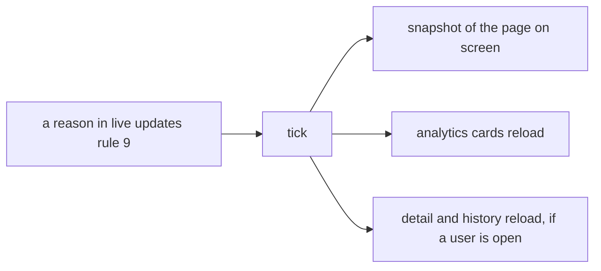

# Dashboard

## Scope

The admin page in the browser: session, API client with shape checks, live user
state, the fixture mode that runs it without an API, and the header that shows
the connection. It applies, and does not define,
[rate limiting](rate-limiting.md#behavior), [admin API](admin-api.md#behavior)
and [live updates](live-updates.md#behavior).

## Behavior

1. **Session.** A field labelled "Admin token", described as demo
   authentication, comes first; nothing is requested before a token is entered.
   The token stays in `sessionStorage` (memory if blocked) until the tab closes;
   no sign-out. A 401 or a refused handshake forgets it and returns to the field
   with "The admin token was not accepted." (Expectation: security)
2. **Requests.** Same origin, bearer token, 10-second limit, never repeated by
   the page ([P17]). A cancelled request is silent; any other failure shows a
   message. A response, event or 401 arriving after its session ended changes
   nothing ([P22]). (Expectation: reliability; Expectation: security)
3. **Shape checks.** A response or socket event that does not match its
   `packages/contracts` type is not used: a bad response fails with "The server
   returned an invalid response."; a bad event is ignored whole, with no row,
   recent request, alert or update time. The browser never computes remaining,
   total or status ([P3]). (Expectation: reliability; Expectation: security)
4. **Live state.** Rows, socket and snapshots are held and ordered as
   [live updates](live-updates.md#behavior) defines ([P21]). The header shows
   "Connecting…", "Live" or "Disconnected, reconnecting…" and, apart, "Last
   update HH:MM:SS UTC" or "No update yet" ([P20]). Every well-formed
   `rate:limit_exceeded` shows a red notification, "Limit exceeded: <id>", with
   "Retry at HH:MM:SS UTC", for 5 seconds; at most 3 show at once, the rest
   wait. (Core feature 1; Expectation: reliability)
5. **Fixture mode.** With `VITE_FIXTURES=1` in development no API is needed: any
   token opens the page, time stands at 10:42:00 UTC, data answers after 150 ms,
   a stand-in socket connects, sends `rate:update` at 2 and 4 s and
   `rate:limit_exceeded` at 6 s, and actions only raise a version. Its 12 rows
   are filtered and paged as the [admin API](admin-api.md#behavior) does. A
   production build holds none of it; `npm run check:contracts` fails if the
   data breaks its rules. (Expectation: maintainability)
6. **Table.** Plain string order of the ID, exactly the headers User ID,
   Remaining / Total, Reset Time, Status and Last Request ([P1]); the server's
   values, minutes to reset ("11:00:00 UTC (18m)"), Status as a coloured badge
   carrying its text ([P33]), a suspension note, "Never" for no request;
   "Loading users…", an error over held rows, "No users match the filters."
   **Interpretation** of "Live User Table: Displays" for a population of any
   size: the table shows the page the server cut, "Users per page" 25, 50
   (default) or 100, with "First page", "Previous page", "Next page" and "Last
   page" buttons, "Page P of N · T matching users" and the time of the read, so
   every user is reachable by page or search. Next and Last page stay disabled
   until the page answers. A changed filter or page size starts at page 1; a
   refresh that leaves the page past the last returns to page 1. (Core feature
   1; Expectation: scalability)
7. **Search and filters.** "Search user ID" (case-insensitive substring, at most
   64 characters, as the API refuses longer), "Status" (Any, OK, Warning,
   Exceeded) and "Last active" combine and are applied by the server to every
   registered user before the page is cut. The Status filter uses the server's
   status, which reads "Warning >= 90%, OK <= 90%" as
   [rate limiting rule 6](rate-limiting.md#behavior) defines. **Interpretation**
   of "last active time": Any time, Last 5 minutes, Last hour or Last 24 hours
   before the server's read, against Last Request; a user who never called
   matches only Any time. A held row keeps updating from events even when it
   stops matching, until the next page read. (Core feature 4)
8. **User detail.** An ID is a button opening a panel with the live row (its
   status as a plain heading, and "Reset HH:MM:SS UTC; last reset HH:MM:SS UTC"
   for the last reset time), recent requests, and the past hour or day as totals
   and a chart; closing returns focus to it. **Interpretation** of "Real-time
   event stream for that user": every dashboard receives every event
   ([live updates](live-updates.md#behavior)) and the panel filters them by
   `userId`; its list gains at once the request an accepted event of that user
   carries, merged by ID, within 24 hours, newest 100. It lists requests, not
   admin actions: an action changes the row and adds no entry. (Core feature 2)
9. **Admin controls.** Reset usage, Set limit, Suspend, Resume throttling and
   Add extra, as in [admin API](admin-api.md#behavior). A number outside its
   range there shows "Enter an integer from 1 to N." and sends nothing. One
   action runs at a time; its returned row is applied as live updates orders. A
   failure keeps the typed input, shows the error and asks for one fresh read.
   The panel has one error, shared by all its controls: it stays until the
   panel's next action starts, an invalid entry in any field replaces it, or the
   panel closes. (Core feature 3)
10. **Analytics.** Four cards, Total users, Near limit, 429 today and Top users
    ("By requests this hour"), load apart from the table, count every registered
    user whatever the table shows, and give the time of their read. Near limit
    prints its definition: users active this hour at 90% or more, exceeded
    included ([P4]). (Core feature 5)
11. **Panels load alone.** Detail, history and cards reload on every tick: each
    time a snapshot is requested for a reason
    [live updates rule 9](live-updates.md#behavior) lists; a new page or filter
    reloads the table only. Each keeps its last data and error until a load
    succeeds; a new key (another user or range) clears the old data and drops
    its late result ([P22]); one failing leaves the others working ([P23]).
    (Expectation: reliability)

## Interface

Consumes the routes of [admin API](admin-api.md#interface), the events of
[live updates](live-updates.md#interface) and `packages/contracts` types. Vite
serves port 5173 and forwards `/api` and `/socket.io` to the API, so calls are
relative; the API serves the built page on its own origin
([platform](platform.md#behavior) rule 9). Defines the `sessionStorage` key
`adminToken` and `VITE_FIXTURES` (development server only; `1` selects
fixtures).

## Decisions

### UI library: Mantine

One family covers forms, alerts and notifications. MUI, Ant Design, shadcn/ui
and Chakra were compared from general knowledge. Cost: every screen is written
against its components and styles, so replacing the library means rewriting the
views.

### Shape checks written by hand

`packages/contracts` holds types only, so a schema library adds a dependency and
a second definition of every payload; the guards in `api/validation.ts` restate
them too, more cheaply. Cost: a field a guard omits goes unnoticed, relations
(remaining against total) are unchecked, and the compiler compares only a
guard's lists of union members with its type.

### Live state in one hook, no state library

Events and snapshots arrive in any order, so `useLiveUsers` starts one session
(`live/liveSession.ts`) that owns rows and the snapshot queue; a query library
would not order them and adds a dependency. Cost: queueing, cancelling and
merging snapshot reads in order are code of this repository to maintain and
test.

### Fixture mode

Screens had to be reviewable without Redis: fixtures sit behind a
development-only import, with no mock server. Cost: data can drift, hence
`fixtures/check.ts`.

## Test plan

Vitest in jsdom (`npm test -w apps/web`), paths under `apps/web/src/`:

- `api/client.test.ts`: bearer token, encoded IDs, each route's method, path and
  body; a 401 reported once, a late one dropped; malformed body; network
  failure; timeout.
- `api/useSession.test.tsx`: an old token's late responses, a 401 included, are
  inert; StrictMode; refusal ends the session first; an action 401.
- `api/fixture-client.test.tsx`: pinned time; versions rise; cancelling stops a
  request; the stand-in socket sends once; filters and plain string order;
  filters apply before the page is cut.
- `live/useLiveUsers.test.tsx`: a malformed event ignored whole. Its ordering,
  snapshot and listener cases, with `live/rows.test.ts`, belong to
  [live updates](live-updates.md#test-plan).
- `lib/latestRequests.test.ts`: last copy wins, newest first, cap of 100.
  `lib/useRequest.test.tsx`: a new key clears and cancels; coalescing; data and
  error kept during a reload; A, B, A.
- `App.test.tsx` (Socket.IO mocked): token first; handshake on its own origin;
  "Loading users…"; five headers; refusal; token kept, or in memory when storage
  is blocked.
- `features/dashboard.test.tsx`: failed snapshot; 24-hour merge; history failure
  isolated; old detail dropped; failed and late actions; invalid input never
  sent; analytics definitions; "shows the user's last reset time in the detail
  panel".
- `features/table/UsersTable.test.tsx`: search, Status and Last active narrow
  the rows and start at page 1; page buttons and "Users per page"; past the last
  page returns to page 1, with "No users match the filters.".
- `features/admin/AdminForms.test.tsx`: numeric bodies; Resume throttling; one
  action at a time. `features/analytics/AnalyticsCards.test.tsx`: a timeout
  stays shown until recovery.
- `assembled.test.tsx`: focus after closing; exceeded event announced; an action
  keeps its row; a failed action's error stays with its panel; analytics failure
  isolated; connection changes announced.
- `fixture-screen.test.tsx`: the fixture screen, and one reload of table,
  detail, history and cards per tick. `fixtures/check.ts` runs as
  `npm run check:contracts`.
- Not covered: charts, "Past day", Last hour, Last 24 hours, "Never", a failed
  detail load, the detail panel's suspension text, the Total users and 429
  values, the notification lifetime and limit.

## Milestone

`npm run check:contracts` ends `fixtures consistent: <n> checks passed`;
`npm test -w apps/web` reports no failure. Then:

1. `VITE_FIXTURES=1 npm run dev -w apps/web`, open http://localhost:5173, enter
   any token, press "Open dashboard": "Live"; within the first 10 s "Last
   update" reads 10:42:00 UTC, then 10:42:01, :02 and :03 at 2, 4 and 6 s, and
   at 6 s "Limit exceeded: user-05" and "Retry at 11:00:00 UTC" show for 5 s.
   The snapshot at 10 s sets it back to 10:42:00, as fixture time stands still.
2. Same page: 12 rows; user-04 Warning; user-09 "Throttling suspended until
   11:30:00 UTC"; user-12 "Never"; user-01 reads 87 / 100 at 2 s; user-06 turns
   from Exceeded to OK at 4 s; the cards read 12, 64% and 41.
3. Open user-09: "Reset 11:00:00 UTC; last reset 10:00:00 UTC" and "Suspension:
   until 11:30:00 UTC"; "Set limit" 1.5 shows "Enter an integer from 1 to
   10000."; Escape closes the panel, focus returns to "user-09". Searching
   "user-1" then leaves user-10, user-11 and user-12.
4. Stop the fixture server (Ctrl+C). Run `cp .env.example .env` (once),
   `docker compose up -d redis` and `npm run dev`, which starts the API and the
   dashboard without fixtures, and open http://localhost:5173 in a new tab (the
   token is kept per tab): a wrong token returns to the field with "The admin
   token was not accepted."; `demo-admin-token` gives "Live" and a "Last update"
   time.
5. With `npm run dev` still running, run `npm run seed:users -- --count 1000` in
   another terminal and reload: "Page 1 of 20 · 1000 matching users" and 50
   rows; "Next page" shows page 2, "Last page" page 20 with "Next page"
   disabled; searching "user-777" shows one row; "Users per page" 100 shows
   "Page 1 of 10"; the Total users card reads 1000 on every page.

## Limits

jsdom is not a browser: layout and real focus are unproven. Every keystroke in
the search field asks for a new page, without a pause, so the server scans the
registry once per keystroke. The token is a shared demo credential any script of
the page can read.

[P1]: ../PITFALLS.md#p1-renaming-what-the-brief-names
[P3]: ../PITFALLS.md#p3-a-status-threshold-that-only-works-for-round-limits
[P4]: ../PITFALLS.md#p4-a-near-limit-figure-that-drops-when-users-get-blocked
[P17]: ../PITFALLS.md#p17-retrying-an-admin-action-automatically
[P20]: ../PITFALLS.md#p20-taking-a-connection-for-delivery
[P21]: ../PITFALLS.md#p21-removing-another-components-listeners
[P22]: ../PITFALLS.md#p22-applying-a-response-without-checking-what-it-was-for
[P23]: ../PITFALLS.md#p23-essential-data-waiting-for-optional-data
[P33]: ../PITFALLS.md#p33-a-status-that-only-its-colour-can-tell
