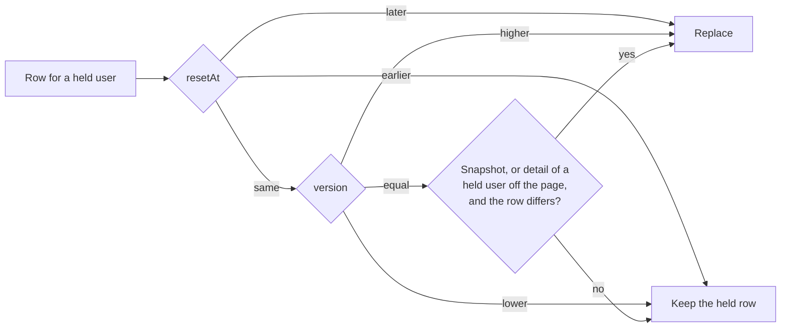
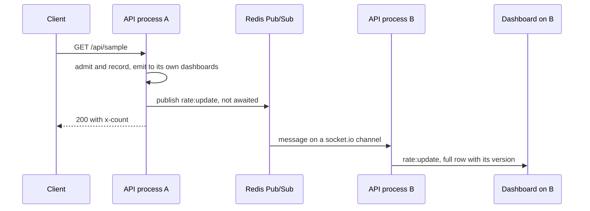

# Live updates

## Scope

The two socket events named in the brief: when each is sent and how a receiver
treats it (payload fields: `packages/contracts`). It answers Core feature 1 of
the [requirements](../REQUIREMENTS.md), Core feature 2 and the quality
expectations.

## Behavior

**Interpretation** of "Updates live via WebSocket … (`rate:update`,
`rate:limit_exceeded`)": the brief is silent on timing; rules 1 and 2 read it.

1. `rate:update` is sent for every admitted request, also one over the cap
   during a suspension, and every admin action, after its write and before its
   HTTP response; never for a rejection or a failed action ([P15]). (Core
   feature 1; Core feature 3)
2. `rate:limit_exceeded` is sent for a user's first rejection in a window
   ([P6]). A reset, an extra grant and every successful limit save, even to a
   lower or equal value, allow one more; a suspension and its removal do not. A
   bookkeeping outage preserves the 429 without an alert; an error reply or
   defect gives 500 without an event
   ([rate limiting](rate-limiting.md#behavior)). (Core feature 1; Backend 6)
3. Both payloads carry the full row, built by the function that builds the HTTP
   row; an action's event row equals its response row. (Core feature 1;
   Expectation: performance)
4. `version` is a per-user counter, raised in the same transaction as every
   admission, rejection and admin action and read in it, so it matches the state
   shown with it. A suspension ending, a new hour and the removal of a rejected
   entry change a row without changing it. (Expectation: reliability)
5. Every connected dashboard receives every event, with no rooms or per-user
   subscriptions; clients send none. A socket that fails the
   [handshake](platform.md#behavior) check receives nothing. The per-user stream
   is a view of these events in the [dashboard](dashboard.md#behavior). (Core
   feature 2; Expectation: security)
6. A failed emit is logged and never fails the request or action that caused it;
   nothing is retried or replayed. (Expectation: reliability)
7. A row from an event, an action's response or a detail response replaces the
   held row of its user only if newer: a later `resetAt`, then a higher
   `version`. Arrival order and repeats therefore change nothing ([P19]). An
   equal row that differs is replaced only by a snapshot (rule 8) and by the
   detail response of a user whose row is held (rule 13) when it arrives, while
   that user is not on the page on screen. The order decides the row and its
   request record only:
   every `rate:limit_exceeded` received shows its alert, whatever row is held.
   (Core feature 1; Expectation: reliability)
8. An event never causes a request. A snapshot (the page of the user list on
   screen, [admin-api](admin-api.md#interface)) replaces a held row unless the
   held one is newer, so it repairs an ended suspension or a removed rejected
   entry. One snapshot runs at a time, with at most one follow-up; a failed one
   keeps the rows. (Core feature 1; Expectation: reliability)
9. A snapshot is requested on every (re)connect, after a failed admin action,
   when the page becomes visible and, only while visible, at the next reset time
   of a held row and every 10 seconds. The 10 seconds are a cadence while the
   page is visible and reads succeed, not a bound on a row's age: in a hidden
   tab, behind a read still pending or after a failed one, a row stays older.
   (Core feature 1; Expectation: reliability)
10. "Last update" is the `at` of the last applied event or the time of the last
    successful snapshot; connecting alone does not set it. (Core feature 1)
11. One hook owns the socket. When its session ends or it unmounts, it removes
    exactly the socket callbacks and timers it added, never another component's,
    and does nothing afterwards ([P21]). (Expectation: maintainability)
12. An event reaches the dashboards of every API process that shares the Redis,
    not only those of the process that sent it ([P20]). A failed relay is logged
    and never fails a request or ends the process; after a Redis outage,
    relaying resumes without a restart. (Expectation: scalability; Expectation:
    reliability)
13. The dashboard holds the rows of the page on screen, of the selected user
    and of the users the table holds in place
    ([dashboard rule 6](dashboard.md#behavior)), at most the page they were
    held from, and no others; it holds the requests events carry only for the
    selected user, the newest 100. An event for anyone else is checked and may
    alert, but nothing of it is kept. Every dashboard still receives every
    event (rule 5): this bounds memory, not traffic. (Expectation:
    scalability; [P9])
14. A new page or filter keeps the socket, cancels the page read in flight and
    at once drops every row except the selected user's, because the new page is
    not known yet; a response for an older page or filter is dropped ([P22]).
    Events that arrive before the new page is shown are applied over its
    response, the newest per user for at most 100 users. A user who now matches
    the filter, or no longer does, joins or leaves the page at the next
    successful snapshot. (Core feature 1; Expectation: reliability)



## Interface

Socket.IO on the HTTP port, default path and namespace, server to client:
`rate:update` (`RateUpdateEvent`, rule 1) and `rate:limit_exceeded`
(`RateLimitExceededEvent`, rule 2). The shared `ServerToClientEvents` map types
every emit, so a renamed event fails to compile ([P1]). Between API processes,
the Socket.IO Redis adapter relays each emit over Redis Pub/Sub, on channels
named with the prefix `socket.io` (rule 12):



## Decisions

### Full row, with a version

Events that only name a user force a read each, overtaken under steady traffic
([P18]). The event carries the row and a counter from one transaction, so the
store orders concurrent changes; a timestamp would depend on host clocks. Cost:
larger messages. Cases: mocked-store specs.

### One alert per window, re-armed by a generation

A blocked client retries at once, so an alert per 429 multiplies work. The
once-per-window flag is keyed by a generation, read with the admission's
decision and incremented by reset, extra and limit saves. Deleting the flag
instead lets a rejection decided before the action set it again; re-arming only
on a raised limit needs a read and a retry. Cost: lowering a limit can alert
again that hour. Cases: interceptor and store specs.

### Window, then version; snapshots repair

Arrival order does not say which row is newer, and a new hour changes a row with
no event, so the window comes first. Only a read with its version in one
transaction may replace an equal row. Last arrival wins undoes a newer event;
cancelling a snapshot can starve the display. The alert is outside this order:
it reports a rejection, which no later row undoes, and a snapshot read after the
rejection can arrive before the event. Cost: each refresh (rule 9) reloads the
page and the analytics cards, and with a detail panel open the detail and its
history too: up to four reads per refresh per visible dashboard, unmeasured. A
change no event carries, including a filtered page whose members no longer
match, stays until the next successful snapshot; a user past the 100 kept during
a page read shows the page's row until their next event or snapshot, since
reading again would let events cause reads. Cases: browser tests.

### A held user's detail repairs it off the page

With pages, the selected user may be on no page the dashboard reads, so no
snapshot would repair an ended suspension or a removed rejected entry for that
user. The detail reloads on every refresh and is read with its version in one
transaction, like a snapshot, so it may replace an equal row for that user while
the user is off the page. The same holds for a user the table holds in place
after the page dropped them, whose detail is read while a field of the row is
open ([dashboard rule 9](dashboard.md#behavior)). Alternative: render the
detail panel from the detail response alone, which splits one user's state in
two places. Cost: one more case in the ordering rule.

### Every dashboard receives every event

Rule 5 sends each event to every admin socket. Rooms or per-user subscriptions
would send a dashboard only what it shows, but each dashboard would subscribe
again whenever its page, filters or selected user change, and a change sent
between two subscriptions would need a repair of its own. Every dashboard is an
admin, so no event needs to be withheld from one. Alternative: rooms per page
or per selected user. Cost: delivery grows with all users' requests times open
dashboards, unmeasured; paging bounds what a dashboard holds, not what it
receives.

### Socket.IO Redis adapter

A dashboard connected to one API process must see the decisions of another
([P20]). The adapter publishes every emit on Redis and each process delivers it
to its own sockets. It does not await its Redis commands, so they are wrapped,
on two connections of their own, to report a failure instead of ending the
process, and a subscription that failed is sent again on reconnect.
Alternatives: one process, whose events stay local; a hand-written Pub/Sub
channel, which repeats the adapter; a message broker, a new service. Cost: two
more Redis connections per process, and an event emitted while Redis is
unreachable is lost. Cases: the adapter spec, the cross-process suite and the
two-process check.

## Test plan

Mocked store and browser: `npm test`. Real store: as
[rate limiting](rate-limiting.md#test-plan) explains.

- API, mocked, under `apps/api/src/`: `live/live.gateway.spec.ts` (handshake,
  failed emit logged), `rate-limit/rate-limit.interceptor.spec.ts` (who emits,
  first rejection alerts), `rate-limit/rate-limit.store.spec.ts` (version,
  generation, which actions re-arm), `admin/admin.controller.spec.ts` (emit
  after write, same row, none on failure), `live/redis-io.adapter.spec.ts`
  (publish and subscription failures reported, subscription re-sent, publisher
  closed on a failed start).
- Browser, under `apps/web/src/`: `live/rows.test.ts` and
  `live/useLiveUsers.test.tsx` (ordering, snapshot repair and triggers, one
  follow-up, alert despite a held version, own listeners removed, new page,
  events during a read, the 100 cap, off-page events, detail repair, users
  held in place: their events off the page, their detail repair, dropped when
  let go or on a new page),
  `features/dashboard.test.tsx` (refresh after a failed action, detail reload on
  tick), `App.test.tsx` and `assembled.test.tsx` (update time, own listeners).
- Real store, `apps/api/test/`: `live-events` (exact row at a socket), `alerts`
  (one per burst, re-arming, a late rejection), `admin-http` (refused
  handshakes, rising version), `cross-process` (relay, wrong token, Redis lost
  and back, publish with Redis stopped, a hung subscription).
- Two-process check, `scripts/two-process-check.mjs`, on a Redis of its own
  whose database it empties: one request through each process uses one quota
  (99, then 98 remaining); 200 concurrent requests over both admit exactly 100,
  each `x-count` from 0 to 99 once, and the window holds 100 entries. Dashboards
  on both, connected before the burst, each receive its single
  `rate:limit_exceeded` with the same request ID, so one got it through Redis. A
  request and a reset on the second process reach a dashboard on the first.

## Milestone

With Redis and `npm run start:dev -w apps/api` running, watch the events from
the repository root, then send requests from another terminal:

```sh
node --input-type=module -e "import { io } from 'socket.io-client'; io('http://localhost:3000', { auth: { token: 'demo-admin-token' } }).onAny((name, e) => console.log(name, JSON.stringify(e)))"
U=http://localhost:3000; T='Authorization: Bearer demo-token-03'
curl -s -H "$T" $U/api/sample
curl -s -X PUT -H 'Authorization: Bearer demo-admin-token' -H 'Content-Type: application/json' -d '{"limit":1}' $U/api/admin/users/user-03/limit
curl -s -H "$T" $U/api/sample; curl -s -H "$T" $U/api/sample
```

The watcher prints, for `user-03`: `rate:update` (cause `request`, on an empty
store `remaining` 99, `version` 1); `rate:update` (cause `limit`, status
`Exceeded`); one `rate:limit_exceeded` with `retryAt` at the next hour. The last
call answers 429 and prints nothing. With `npm run dev` and the
[dashboard](dashboard.md#behavior) signed in, a request as another user,
`curl -s -H 'Authorization: Bearer demo-token-04' $U/api/sample`, changes the
`user-04` row in place, with no request made because of the event.

Across processes, on a Redis of its own: Redis Pub/Sub is not per database, so
on the development Redis the check's events would reach the running API and the
watcher ([how to run](../../README.md#verification)).

```sh
docker run -d --rm --name bouncer-test-redis -p 127.0.0.1:6380:6379 redis:8-alpine
npm run build && TEST_REDIS_URL=redis://127.0.0.1:6380/1 npm run check:two-process
```

It prints
`One rate:limit_exceeded event, the same at the dashboards on both processes`,
`Cross-process request event received` and `Cross-process reset event received`,
and exits 0.

## Limits

- Two processes emit in no set order; the version orders the rows (rule 7). A
  client that polls through a load balancer needs session affinity, which is
  neither provided nor tested.
- Delivery across processes is checked only by the cross-process suite and the
  two-process check: two processes of one host and one Redis, not under load. No
  throughput or latency figure is measured.
- Event volume has no bound: every event reaches every dashboard, and during a
  suspension every request sends one.
- The dashboard keeps no record of alerts shown, so an event delivered twice
  would alert twice, and an alert that arrives after a newer row, for example
  after a reset, still shows for its 5 seconds.

[P1]: ../PITFALLS.md#p1-renaming-what-the-brief-names
[P6]: ../PITFALLS.md#p6-rejections-that-multiply-work
[P9]: ../PITFALLS.md#p9-storing-something-without-a-bound
[P15]: ../PITFALLS.md#p15-answering-before-the-write-has-settled
[P18]: ../PITFALLS.md#p18-events-that-only-say-something-changed
[P19]: ../PITFALLS.md#p19-an-older-snapshot-overwriting-a-newer-event
[P20]: ../PITFALLS.md#p20-taking-a-connection-for-delivery
[P21]: ../PITFALLS.md#p21-removing-another-components-listeners
[P22]: ../PITFALLS.md#p22-applying-a-response-without-checking-what-it-was-for
