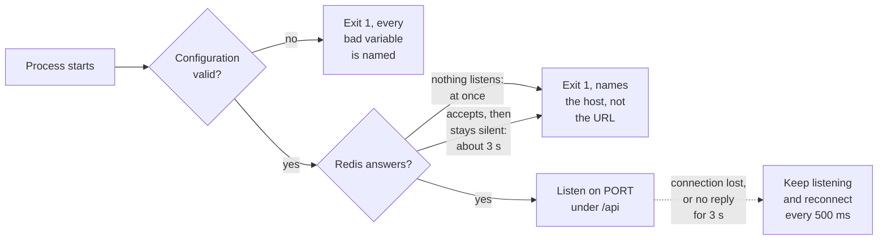

# Platform

## Scope

The workspace, start-up configuration, who a caller is, the Redis connection,
the health route and the error response. Items are cited as
[the requirements][req] name them: *Backend N*, *Core feature N*,
*Submission*, *Expectation: quality*.

## Behavior

1. **Workspace.** `apps/*` and `packages/*` form one npm workspace, and
   `packages/contracts` holds types only. The root `package.json` holds the
   shared scripts and the compiler; each workspace declares its own
   dependencies. (Backend 2; Submission; Expectation: maintainability)
2. **One function checks the configuration before the API listens.** A
   missing or malformed variable of [`.env.example`][env] stops the process
   with one error that names every bad variable and shows no value. A user ID
   matches `[A-Za-z0-9_-]{1,64}`, so it holds no `:`; repeated IDs or tokens,
   and a user token equal to the admin token, are refused. (Backend 1;
   Expectation: reliability; pitfalls [P10], [P11])
3. **Interpretation of "based on user id, and not IP/MAC" (Backend 1).** The
   brief does not say how a caller becomes known. A guard sets the ID that the
   bearer token maps to in `DEMO_USERS`; a client-sent ID is ignored and no
   network address is read, so no caller can spend another's quota. A missing,
   unknown or admin credential is a 401 before any quota is touched.
   (Backend 1; Expectation: security)
4. **Interpretation of "Admin Controls" (Core feature 3).** The brief names
   no admin identity. One `ADMIN_TOKEN`, compared in constant time, is
   required as `Authorization: Bearer` on every admin route and as
   `auth.token` in the socket handshake, which fails with `Unauthorized`
   before any event, since events carry every user's usage. A user token is
   refused, and a refused call changes nothing. (Core feature 1, 3;
   Expectation: security)
5. **The API does not listen until Redis has answered**; otherwise it exits,
   naming the host and not the URL: at once when nothing listens, within
   about 3 s when the peer accepts the connection and never answers. On
   SIGTERM it waits at most 1 s for the replies it is owed, then closes.
   (Expectation: reliability)
6. **Every error body is `ApiError`.** An exception keeps its status, message
   and extra fields, such as a 429's retry time; an unavailable store is the
   503 of [rate limiting](rate-limiting.md#behavior); any other error is a 500
   "Internal server error" whose cause is logged, not sent. (Backend 6;
   Expectation: security; pitfall [P8])
7. **A Redis that stops answering after start-up is noticed within about
   4 s, with or without traffic.** The connection is closed, so every command
   still waiting fails, which a caller sees as the 503 of
   [rate limiting](rate-limiting.md#behavior). The client then reconnects
   every 500 ms and the API serves again without a restart. A Redis that is
   stopped, not hung, is noticed at once. (Expectation: reliability)
8. **Addition: `GET /api/health`, without a credential.** It answers 200
   `HealthResponse` when Redis answers a `PING`, else a 503 `ApiError`
   "Redis is not reachable." within the bound of rule 7, so a readiness
   check covers the store that every request needs. (Expectation:
   reliability)

The start-up of rules 2 and 5, and the outage of rule 7, in one picture:



## Decisions

**Identity comes from a credential.** The brief wants a quota "based on user
id" but gives no way to know the caller, and a client-sent ID lets one user
drain another's quota. A guard maps a seeded bearer token to the ID; an
identity provider, which the brief does not ask for, would replace only that
lookup. Cost: the demo tokens are public. Cases: the guard spec.

**One types-only package carries the shared contract.** The dashboard and API
must agree on every payload, and copies drift. Both import `@app/contracts`,
which holds types only because the server computes the status. Alternative:
Nest's monorepo mode, which restructures the repository around its CLI for a
dashboard that is not a Nest project. Cost: no build step, so a toolchain
that cannot read the package would force one. Cases: the build.

**Configuration is checked once, before listening.** A misconfigured service
should refuse to start, not fail request by request. `loadConfig`, a pure
function of the environment, runs while Nest builds the application, so
`NestFactory.create` fails before anything listens. Alternatives:
`@nestjs/config` (a dependency for four variables); reading a variable where
it is used ([P10]). Cost: a change needs a restart. Cases: the config spec,
the milestone.

**One filter gives every error one shape.** A client should not parse a body
per source: Nest's differ between an exception, a middleware error and a list
of validation messages, and a defect's text could leak. A global filter
rebuilds each as `statusCode`, `error` and `message`. Alternative: the
default handling, route by route. Cost: the filter must follow Nest's own
classification of errors. Cases: the filter spec; the 404 step.

**One Redis client fails fast at start, then retries.** The API is useless
without Redis but should survive its restart. The client connects while the
application is built, with 1 s for the TCP connection. A socket silent for
3 s is closed, which covers a peer that accepts and never answers; a `PING`
every second keeps a healthy idle connection from looking silent. Before its
first success the reconnect strategy returns the error, so start-up fails;
afterwards it retries every 500 ms. Alternative: the defaults, which wait
without limit on a silent peer and treat a socket timeout as final. Cost:
this is a limit on silence, not on the total time to start, so a peer that
keeps sending an unfinished reply is not cut off. Cases: the Redis module
spec; the milestone.

**A watchdog closes a connection that has stopped answering.** A request must
not wait without limit on a hung store. The socket timeout cannot see one
under traffic: it measures inactivity in both directions, so every command
written restarts it. The reply to the once-a-second `PING` is therefore the
sign of life: a timer checks it every second, and after 3 s without one it
destroys the connection, which fails the commands in flight, and connects
again. The silence is measured on a monotonic clock, so a change of the system
time neither looks like silence nor hides it. Alternatives: a deadline on each
command, which every call site must set and which leaves the connection queued
behind the hung commands; the socket timeout alone, which only covers an idle
connection. Cost: a command that runs longer than 3 s on the server is cut off
like a hung one, so no blocking command may use this client; and a write that
was cut off may or may not have been applied. Cases: the Redis module spec;
the outage cases.

## Test plan

Unit, no Redis (`npm test`):
- `apps/api/src/config/config.spec.ts`: a valid environment parses; each
  missing or malformed variable and bad `DEMO_USERS` entry is refused; all
  problems come in one error, with no credential in it.
- `apps/api/src/auth/user-token.guard.spec.ts`: the token's ID is set; a bad
  header, an unknown token and the admin token are 401; a sent ID is ignored.
- `apps/api/src/api-error.filter.spec.ts`: status, message and extra fields
  are kept; a list of messages becomes one; a hidden middleware detail is
  withheld; any other error is a logged 500; a reply already begun is left.
- `apps/api/src/redis/redis.module.spec.ts` (TCP only, no Redis): start-up
  fails on a closed port, and on a peer that accepts and never answers; a
  peer that stops answering while commands keep arriving fails the command
  in flight within 5 s, also with the system time standing still; a peer
  that stops answering while the client is idle is cut off within 5 s; in
  both cases the same client works once it answers again; a system time
  that jumps forward does not close a healthy connection; a closed
  connection keeps neither the watchdog's timer nor its listeners.
- `apps/api/src/health/health.controller.spec.ts`: 200 when `PING` answers;
  a failed `PING` is the 503 body of rule 8; while the connection is down
  the 503 comes without a `PING`.

Real store (run as in [rate limiting](rate-limiting.md#test-plan)):
- `apps/api/test/outage.e2e-spec.ts`: behind a TCP relay that is stopped,
  and one that is frozen while requests keep arriving, a sample request and
  an admin action get a 503 without `x-count` within 5 s and later ones
  within 0.5 s; once the relay passes traffic again both succeed without a
  restart.
- `apps/api/test/health.e2e-spec.ts`: without a credential, health is 200;
  behind a stopped relay it is the 503 of rule 8; behind a frozen one, the
  same 503 within 5 s and later ones within 0.5 s; 200 again once the relay
  passes traffic.

Rule 4: the handshake cases are in the test plan of
[live updates](live-updates.md#test-plan); a missing and a user token on
every admin route are in that of the [admin API](admin-api.md#test-plan).

Rule 5: the wait of at most 1 s on SIGTERM has no case.

## Milestone

```sh
npm ci && npm run build && npm run lint && npm test
cp .env.example .env
PORT=0 node apps/api/dist/main.js  # a set variable wins over .env
node apps/api/dist/main.js     # with nothing listening on port 6379
docker compose up -d redis
npm run start:dev -w apps/api  # leave running
curl -i localhost:3000/api/nothing
curl -s localhost:3000/api/health
```

The first line exits 0. The third exits 1 with `Invalid configuration:` and
`- PORT must be a whole number from 1 to 65535`; the fourth exits 1 with
`Cannot connect to Redis at localhost:6379` and the advice to start it. The
first `curl` shows a 404 `ApiError` saying `Cannot GET /api/nothing`; the
second prints `{"status":"ok"}`, and after `docker compose stop redis` a 503
`ApiError` saying `Redis is not reachable.`

## Limits

Demo authentication is not production authentication: the tokens are static
and public, with no expiry, revocation, per-person admin identity or
failed-attempt limit, and user tokens are not compared in constant time. There
is no TLS and the Redis in Compose has no password. Replication and failover
are not covered, and the connection log has no test.

[req]: ../REQUIREMENTS.md
[env]: ../../.env.example
[P8]: ../PITFALLS.md#p8-catching-every-error-around-the-store-call
[P10]: ../PITFALLS.md#p10-discovering-bad-configuration-on-a-request
[P11]: ../PITFALLS.md#p11-a-user-id-that-is-not-one-plain-string
