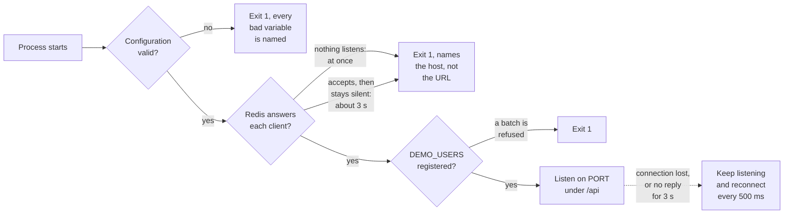

# Platform

## Scope

The workspace, start-up configuration, who a caller is, the user registry,
the Redis connections, the health route, the error response and the two run
modes, on the host and in containers. Items are cited as
[the requirements][req] name them: *Backend N*, *Core feature N*,
*Submission*, *Expectation: quality*.

## Behavior

1. **Workspace.** `apps/*` and `packages/*` form one npm workspace;
   `packages/contracts` holds types only. The root `package.json` holds the
   shared scripts; it, `apps/api` and `apps/web` each declare TypeScript, and
   each workspace its own dependencies. (Backend 2; Submission; Expectation:
   maintainability)
2. **The configuration is checked before the API listens.** A missing or
   malformed variable of [`.env.example`][env] stops it with one error that
   names every bad variable and shows no value; only `DEMO_USERS` may be
   empty. A user ID matches `[A-Za-z0-9_-]{1,64}`, so it holds no `:`;
   repeated IDs or tokens, and a user token equal to the admin token, are
   refused. (Backend 1; Expectation: reliability; pitfalls [P10], [P11])
3. **Interpretation of "based on user id, and not IP/MAC" (Backend 1).** The
   brief does not say how a caller becomes known. The ID is the one the
   registry (rule 11) holds for the token in `Authorization: Bearer <token>`,
   the scheme in any case and exactly one token; a client-sent ID is ignored
   and no network address is read. A missing, unknown or admin token, even
   one a user registered before the admin token changed, is a 401, and an
   unreadable registry a 503, before any quota is touched. (Backend 1;
   Expectation: security)
4. **Interpretation of "Admin Controls" (Core feature 3).** The brief names
   no admin identity. One `ADMIN_TOKEN`, compared in constant time, is
   required as `Authorization: Bearer` on every admin route and as
   `auth.token` in the socket handshake, which otherwise fails with
   `Unauthorized` before any event. A user token is refused; a refused call
   changes nothing. (Core feature 1, 3; Expectation: security)
5. **The API does not listen until Redis has answered**; otherwise it exits,
   naming the host and not the URL: at once when nothing listens, within
   about 3 s when the peer accepts and never answers. On SIGTERM it closes
   the adapter's two Redis clients together, then the main one; each step
   waits at most 1 s for the replies it is owed, so at most about 2 s in
   all. (Expectation: reliability; pitfall [P26])
6. **Every error body is `ApiError`.** An exception keeps its status, message
   and extra fields, such as a 429's retry time; an unavailable store is the
   503 of [rate limiting](rate-limiting.md#behavior); any other error is a
   500 "Internal server error" whose cause is logged, not sent. (Backend 6;
   Expectation: security; pitfall [P8])
7. **A Redis that stops answering after start-up is noticed within about
   4 s, with or without traffic**, and at once if it is stopped; a change of
   the system time neither causes nor hides it. Every command still waiting
   fails, seen as the 503 of rule 6; the client reconnects every 500 ms and
   the API serves again without a restart. (Expectation: reliability;
   pitfall [P27])
8. **Addition: `GET /api/health`, without a credential.** It answers 200
   `HealthResponse` when Redis answers a `PING`, else a 503 `ApiError`
   "Redis is not reachable." within the bound of rule 7. (Expectation:
   reliability)
9. **Addition: one origin.** The API also serves the built dashboard, so the
   page, the API and the socket share one origin and the API sends no CORS
   headers. A path under `/api` or `/socket.io` is never the page: an unknown
   `/api` path is a 404 `ApiError`. (Expectation: security)
10. **Addition: one image, and Compose on loopback.** The image holds the API
    and the built dashboard and runs as the unprivileged `node` user. Compose
    publishes Redis and the application on `127.0.0.1` only, as Redis has no
    password and the demo credentials are public, and counts the application
    healthy once rule 8 answers 200. (Expectation: security; Expectation:
    reliability)
11. **The user registry in Redis is the list of users.** A token and an admin
    route's user ID are looked up there each time; no process holds the whole
    list, and nothing caps its size. Registering writes no quota key, so it
    never changes usage, history or policy. A token is kept only as its
    SHA-256 digest, and no route or event returns one. (Backend 1;
    Expectation: scalability; Expectation: security; [P9])
12. **Registering only adds.** The API registers `DEMO_USERS` at start-up; the
    seed command registers `user-01` with `demo-token-01` through N, numbered
    with at least two digits. A registered ID keeps its token, so a rerun or a
    smaller N adds nothing. Batches hold at most 100 users and are tried at
    most 10 times; writers registering the same users at once register each
    once and refuse none. A batch with a malformed or repeated identity, the
    admin token or another user's token is refused whole, earlier batches
    staying; at start-up that stops the API. The command prints one JSON line:
    `processed`, `added` and `total`, or on exit 1 `processed`, `added` and
    `error`, counting confirmed batches only, so a rerun resumes. A bad
    `--count` exits 1 with the usage. Its connection neither queues nor
    reconnects: refused, not accepted within 3 s, or with a command unanswered
    for 3 s, it exits 1. (Expectation: reliability)

The start-up of rules 2, 5 and 12, and the outage of rule 7, in one picture:



## Interface

| Route, command or key | Holds or does |
| --- | --- |
| `GET /api/health` | `HealthResponse`, or a 503 `ApiError` (rule 8) |
| `npm run seed:users -- --count N` | Rule 12. Builds the API, then reads `.env.example`, then `.env`; a set variable wins |
| `rl:registry:ids` | Sorted set of every user ID, all with score 0, so ordered by ID; no expiry |
| `rl:registry:users` / `rl:registry:tokens` | Hashes: user ID to token digest, and back; no expiry |

## Decisions

### Identity comes from a credential

The brief wants a quota "based on user id" but no way to know the caller, and
a client-sent ID lets one user drain another's quota. A guard maps a
registered bearer token to the ID; an identity provider, not asked for, would
replace only that lookup. Cost: the demo tokens are public. Cases: the guard.

### Users are registered in Redis, not configured

Thousands of users do not fit in a variable every process repeats, and Redis
already holds the quota. A batch is one transaction under `WATCH` on its own
connection, read again if another writer changed the registry. Alternatives:
a file per process, which needs restarts and can disagree; a database, a
second store. Digests keep a copy of Redis from giving credentials away.
Cost: one more read per request; a Redis outage also fails authentication,
with 503. Cases: the guard, the registry cases.

### One types-only package carries the shared contract

Dashboard and API must agree on every payload, and copies drift. Both import
`@app/contracts`, types only as the server computes the status. Alternative:
Nest's monorepo mode, built around its CLI for a dashboard that is not Nest.
Cost: with no build step, a toolchain that cannot read the package would
force one. Cases: the build.

### Configuration is checked once, before listening

A misconfigured service should refuse to start, not fail per request. A pure
function of the environment runs while Nest builds the application.
Alternatives: `@nestjs/config`, a dependency for four variables; reading a
variable where it is used ([P10]). Cost: a change needs a restart. Cases: the
config spec, the milestone.

### One filter gives every error one shape

Nest's bodies differ between an exception, a middleware error and a list of
validation messages, and a defect's text could leak. A global filter rebuilds
each as `statusCode`, `error` and `message`. Alternative: the default, route
by route. Cost: the filter must follow Nest's classification of errors.
Cases: the filter spec; the 404 step.

### Redis clients fail fast at start, then retry

The API is useless without Redis but should survive its restart. Every client
gets the same options and watchdog: the main one, one for start-up
registration when `DEMO_USERS` is set, and the two of the
[socket adapter](live-updates.md#socketio-redis-adapter). A failure before the
first success is final; a socket silent for 3 s is closed. Alternative: the
defaults, which wait without limit on a silent peer. Cost: silence is
limited, not the time to start, so a peer sending an unfinished reply is not
cut off. Cases: the Redis module spec; the milestone.

### A watchdog closes a connection that has stopped answering

Every command written restarts the socket timeout, so it misses a hang under
traffic; the reply to a `PING` sent each second is the sign of life instead,
and 3 s without one destroys the connection. Alternatives: a deadline per
command, set at every call site and leaving the connection queued behind hung
commands; the socket timeout alone. Cost: a command longer than 3 s is cut
off too, so no blocking command may use these clients, and a write cut off
may or may not have been applied. Cases: the Redis module spec; outage cases.

### The API serves the dashboard

A page on another origin needs CORS on the API and the handshake, and a
second server. Served by the API, the page uses relative URLs; in
development Vite forwards `/api` and `/socket.io`. Alternatives: a static
host or proxy, one more service; CORS, which widens what other origins may
call. Cost: a changed page needs a new image. Cases: one-origin; Compose.

## Test plan

Unit, no Redis (`npm test`), in `apps/api/src/`:
- `config/config.spec.ts`: rule 2, every bad variable and `DEMO_USERS` entry.
- `auth/user-token.guard.spec.ts`: rule 3, scheme case, bad headers, sent ID.
- `users/seed-users.spec.ts`: rule 12, numbering, refusals, confirmed progress.
- `users/seed.spec.ts`: rule 12, the seed command exits 1 with one JSON line
  when Redis refuses the connection.
- `api-error.filter.spec.ts`: rule 6; a reply already begun is left alone.
- `redis/redis.module.spec.ts`, TCP peers: rules 5 and 7, idle, busy, clock.
- `health/health.controller.spec.ts`: rule 8; no `PING` while disconnected.

Real store, in `apps/api/test/`, run as in
[rate limiting](rate-limiting.md#test-plan):
- `registry.e2e-spec.ts`: rules 3, 11, 12 with 10000 users and two writers;
  "stops the start-up registration when a DEMO_USERS token belongs to another
  user".
- `outage.e2e-spec.ts`, `health.e2e-spec.ts`: rules 7 and 8 behind a stopped
  and a frozen TCP relay, then recovery without a restart.
- `one-origin.e2e-spec.ts`, after `npm run build`: rule 9; no CORS header on
  a request or a preflight from another origin.

Rule 4 is in the plans of [live updates](live-updates.md#test-plan) and the
[admin API](admin-api.md#test-plan).

## Milestone

With ports 3000 and 6379 free:

```sh
npm ci && npm run build && npm run lint && npm test && cp .env.example .env
PORT=0 node apps/api/dist/main.js  # a set variable wins over .env
node apps/api/dist/main.js
docker compose up --wait redis
npm run start:dev -w apps/api      # in a second terminal; leave running
curl -i localhost:3000/api/nothing
npm run seed:users -- --count 1000 && npm run seed:users -- --count 10
curl -si -H 'Authorization: Bearer demo-token-1000' localhost:3000/api/sample
docker compose stop redis && curl -s localhost:3000/api/health
npm run seed:users -- --count 10
docker compose down -v             # after Ctrl+C in the API's terminal
```

The first line exits 0. `PORT=0` exits 1 with `Invalid configuration:` and
`- PORT must be a whole number from 1 to 65535`; the next exits 1 with
`Cannot connect to Redis at localhost:6379` and the advice to start it. The
`curl` shows a 404 `ApiError` saying `Cannot GET /api/nothing`. The seeds
print `"added":988,"total":1000` (the 12 `DEMO_USERS` are the first 12
generated users), then `"added":0,"total":1000`; the sample answers 200 with
`x-count: 99`. With Redis stopped, health is a 503 `ApiError` saying
`Redis is not reachable.`, and the seed exits 1 after one JSON line with
`error`. Then, in containers:

```sh
docker compose up --build --wait
curl -s 127.0.0.1:3000/ | grep -o '<title>.*</title>'
curl -s 127.0.0.1:3000/api/health
curl -si -H 'Authorization: Bearer demo-token-01' 127.0.0.1:3000/api/sample |
  grep -i '^x-count'
docker compose exec app whoami
npm run demo:traffic               # leave running; Ctrl+C stops it
docker compose down -v
```

`up` returns once both services are healthy. The page prints
`<title>Rate limit dashboard</title>`, health `{"status":"ok"}`, the sample
`x-count: 99`, and `whoami` prints `node`. Once the traffic prints its trickle
line, `http://127.0.0.1:3000` signed in with `demo-admin-token` shows
`user-02` to `user-04` as OK, `user-05` as Warning and `user-06` as Exceeded.

## Limits

Demo authentication is not production authentication: static public tokens,
no expiry, revocation, per-person admin identity or failed-attempt limit, and
user tokens not compared in constant time. No TLS; the Compose Redis has no
password. Users cannot be removed or change tokens; Redis memory bounds the
registry, and a registry lost with Redis data is seeded again without its
usage. Replication and failover are not covered. Untested: the wait on
SIGTERM, the seed command's two 3 s silences, the connection log. Compose
runs one API container on one host: a demo, not a deployment.

[req]: ../REQUIREMENTS.md
[env]: ../../.env.example
[P8]: ../PITFALLS.md#p8-catching-every-error-around-the-store-call
[P9]: ../PITFALLS.md#p9-storing-something-without-a-bound
[P10]: ../PITFALLS.md#p10-discovering-bad-configuration-on-a-request
[P11]: ../PITFALLS.md#p11-a-user-id-that-is-not-one-plain-string
[P26]: ../PITFALLS.md#p26-a-store-that-accepts-the-connection-and-never-answers
[P27]: ../PITFALLS.md#p27-measuring-silence-with-the-wall-clock
