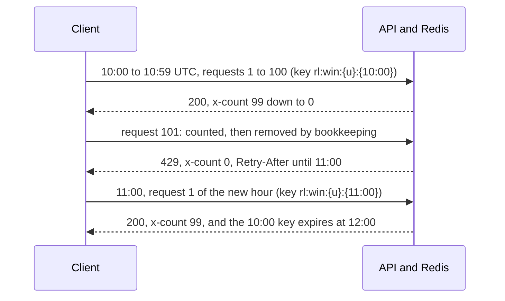

# Rate limiting

## Scope

The per-user quota of the sample routes: windows, admission, `x-count`, the 429
and store errors. It answers Backend 1 to 7 of
[the requirements](../REQUIREMENTS.md), Core features 1 to 4 in part and
reliability, cited (Backend 5), (Core feature 1), (Expectation: reliability).

## Behavior

1. **Interpretation of "Resets the count every hour".** The window is one UTC
   clock hour: zero at each boundary, Reset Time the next one. One clock reading
   decides the window and suspension for the quota and dates its record; the
   sample body's `at` is read separately. (Backend 3; [P25])
2. The cap is the limit (100 unless a custom one is stored) plus the window's
   extra grant. Counting a request and fixing its position is one store
   transaction, so concurrent requests never pass it. (Backend 5; [P24])
3. **Interpretation of "Limits each user to 100 requests per hour".** An
   admitted request uses one unit even if its handler fails; a rejected one
   none: its row leaves it out and rule 10 removes its entry. Until that
   removal runs, or for the rest of the window if it fails, the entry still
   counts against the user's later requests. (Backend 3)
4. Over the cap while the stored suspension end is later than the request's
   clock reading, a request is admitted as bypassed and counted. The end time
   decides, not whether the key exists. (Core feature 3; [P12])
5. One function, `buildRow`, builds every `UserRow`, so the table cannot
   disagree with the limiter. (Core feature 1; Core feature 2)
6. **Interpretation of "Warning >= 90%, OK <= 90%".** Exactly 90% sits in two
   bands; it is Warning. Exceeded at `used >= total`, else Warning when, in
   integers, `used * 100 >= total * WARNING_PERCENT` (90). (Core feature 4;
   [P3])
7. Every admitted request, bypassed ones too, carries `x-count`: the remaining
   quota in the row its own admission produced (99 for a fresh user, 0 for the
   hundredth), never read again. (Backend 4; [P2])
8. A rejected request gets 429, `x-count: 0`, no handler run and a
   `RateLimitedError` body: `message` "Rate limit of 100 requests per hour
   exceeded. Try again at HH:00:00 UTC." (with the effective cap), `retryAt`
   (the next boundary), `retryAfterSeconds`. **Addition:** `Retry-After`, whole
   seconds rounded up, at least 1. (Backend 6)
9. In admission, a disconnected client or a transaction rejection other than the
   Redis client's `ErrorReply` becomes `StoreUnavailable`: 503 "The request was
   not processed. It may be retried." without `x-count` or handler run. An
   `ErrorReply` (also `MultiErrorReply`) or an error outside the transaction is
   a generic 500, details logged, not returned. Neither promises untouched
   quota; no retry or per-process fallback. (Expectation: reliability; [P8])
10. Bookkeeping, a second transaction before the handler, removes a rejected
    entry and records the outcome. `StoreUnavailable` there is logged and keeps
    the admission or 429; an `ErrorReply` or defect gives a 500 without
    `x-count`, handler run or events. Nothing is rolled back and admitted quota
    is not refunded. Events follow [live updates](live-updates.md#behavior)
    rules 1 and 2. (Core feature 1; [P6], [P7])
11. A request that reaches the interceptor without a `userId`, or with an empty
    or non-string one, gets 401 before any store call, header, event or handler,
    so the interceptor applied without its guard never builds a shared bucket.
    (Backend 1)

## Interface

`GET /api/sample` (`SampleResponse`) and `GET /api/sample/fail` (same quota,
then fails) alone use `RateLimitInterceptor` (Backend 2), after the
[identity guard](platform.md#behavior).

| Key (`{u}` user ID, `{h}` window start in ms, `{g}` generation) | Holds | Expiry ([P9]) |
| --- | --- | --- |
| `rl:win:{u}:{h}` | sorted set, one request ID per counted request | end + 1 h |
| `rl:extra:{u}:{h}`, `rl:notified:{u}:{h}:{g}` | grant; flag: alert sent | end + 1 h |
| `rl:suspend:{u}` | suspension end, ms since the epoch | at that time |
| `rl:limit:{u}`, `rl:user:{u}` | custom limit; hash `v`, `g`, last request and reset times | none; per user |
| `rl:hist:{u}` | at most 100 recent request records | 24 h after last write |
| `rl:stat:{u}:{h}` | admitted/denied counts by minute | 25 h after window start |
| `rl:denied:{UTC day}` | daily rejection count | 48 h after last write |

## Decisions

### Concurrent safety

Backend 5 asks that no request slip through, so the decision rests on a position
the write itself claims: one `MULTI`/`EXEC` adds a unique ID to the window set,
then reads the count, which includes the request, and the policy. A store-side
script decides in one trip but moves the logic away from the mocked tests;
`INCR` plus `EXPIRE` can leave a key without expiry ([P5]). Cost: a second
transaction, for bookkeeping; rejected and bypassed entries stay until removed
or expired.

### Fixed hour

A rolling window is exact but needs another structure; the fixed hour allows
twice the cap across a boundary and needs synchronized clocks. Keys expire an
hour late so a slow clock never counts 1 on a deleted key.



### Error classification

Classify by the client's error type in one transaction wrapper: a server error
reply is a 500, other execution failures are unavailable, so a wrong-type key is
not labelled an outage ([P28]). Parsing message prefixes would couple policy to
error text; a catalogue of transient replies (`LOADING`, `BUSY`, `READONLY`) is
deferred, so they are 500 too. Bookkeeping tolerates unavailability but exposes
error replies and defects.

## Test plan

Mocked store (`vitest-mock-extended`, no Redis), in `apps/api/src/`:
- `rate-limit/rate-limit.store.spec.ts`: rules 2, 3, 4, 9, 10.
- `rate-limit/rate-limit.interceptor.spec.ts`: rules 1, 7, 8, 9, 10, 11.
- `sample/sample.controller.spec.ts`: rules 3, 8, 9 over HTTP.
- `rate-limit/row.spec.ts`: rules 4, 5, 6 (limits 100 and 11).
- `rate-limit/keys.spec.ts`: rules 1, 8 (a millisecond around the hour); key
  names, expiries.

Real store, in `apps/api/test/`, with the whole application (command and Redis
server in the [README](../../README.md#verification); the suite empties its
database):
- `admission.e2e-spec.ts`: rules 1, 3, 7, 8, 9; a 401 and a spoofed ID count
  nothing.
- `concurrency.e2e-spec.ts`: rules 2, 7: 200 concurrent requests admit exactly
  100; [P7].
- `store-races.e2e-spec.ts`: rules 1, 3, 10: clocks on both sides of an hour, a
  skipped cleanup.
- `expiry.e2e-spec.ts`: rule 4 and every expiry of the key table.

Two API processes sharing one quota: [live updates](live-updates.md#test-plan).

## Milestone

```sh
npm ci && cp .env.example .env && docker compose up -d redis
npm test && npm run start:dev -w apps/api
# Second shell, on a fresh store and within one UTC hour:
U=localhost:3000/api/sample; T='Authorization: Bearer demo-token-03'
for h in 'X-None: 1' 'Authorization: Bearer wrong'; do
  curl -si -H "$h" $U | head -1; done
for i in $(seq 100); do curl -si -H "$T" $U | grep -iE '^(HTTP|x-count)'; done
curl -si -H "$T" $U
```

Expect `HTTP/1.1 401` twice, `HTTP/1.1 200` with `x-count` 99 down to 0, then
the whole 429: `Retry-After` up to 3600, `x-count: 0` and the body of rule 8.
After `docker compose stop redis` a request gets 503 without `x-count` once the
disconnect is detected; no total deadline is promised. After `start` and then
`pause`, the same 503 comes within about 4 s ([platform](platform.md#behavior),
rule 7); after `unpause` the API answers again without a restart:
`curl -si localhost:3000/api/health | head -1` is 200, and the request above
gets its 429 again, that user's hour being used up.

## Limits

Mocked-store tests cannot show shared-store atomicity. A boundary burst of twice
the cap is possible; bypassed requests and a failed cleanup leave entries above
the cap until the key expires. A rejected entry counts against concurrent
requests until its removal runs, so a request sent at once after an extra grant
can still be refused; no test covers that interleaving. One Redis only.

[P2]: ../PITFALLS.md#p2-putting-the-used-count-in-x-count
[P3]: ../PITFALLS.md#p3-a-status-threshold-that-only-works-for-round-limits
[P5]: ../PITFALLS.md#p5-setting-the-count-and-its-expiry-in-two-steps
[P6]: ../PITFALLS.md#p6-rejections-that-multiply-work
[P7]: ../PITFALLS.md#p7-one-users-flood-slowing-everyone-else
[P8]: ../PITFALLS.md#p8-catching-every-error-around-the-store-call
[P9]: ../PITFALLS.md#p9-storing-something-without-a-bound
[P12]: ../PITFALLS.md#p12-a-temporary-suspension-that-never-ends
[P24]: ../PITFALLS.md#p24-tests-that-do-not-exercise-what-runs
[P25]: ../PITFALLS.md#p25-time-tests-that-do-not-control-time
[P28]: ../PITFALLS.md#p28-a-broken-key-reported-as-an-outage
